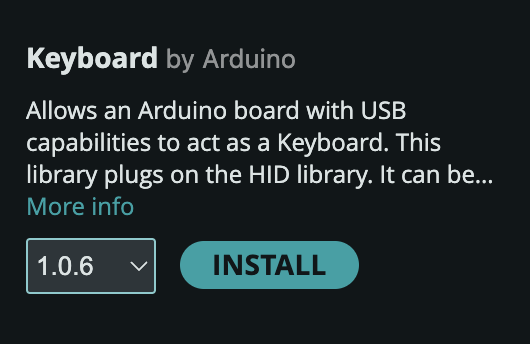
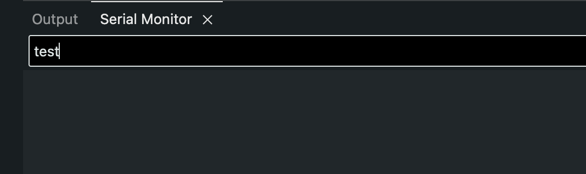
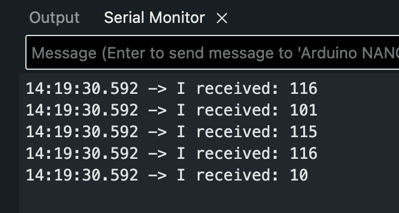

# Keyboard and Mouse

## Intro

The Nano 33 IoT can act like a USB **keyboard** or **mouse**, and your computer can't tell the difference. That means anything you build can control anything on your computer: a game, a p5.js sketch, a slideshow or a music program, with no extra software.

The official Arduino documentation is a more complete reference:

::: {.topics}

::: {.card type="external" title="Keyboard" thumb="../../../images/arduino_docs.svg" href="https://docs.arduino.cc/language-reference/en/functions/usb/Keyboard/" tag="Docs"}
:::

::: {.card type="external" title="Mouse" thumb="../../../images/arduino_docs.svg" href="https://docs.arduino.cc/language-reference/en/functions/usb/Mouse/" tag="Docs"}
:::

:::

Let's start with the keyboard, using one of the built-in examples.

Go to:

**File** > **Examples** > **09.USB** > **Keyboard** > **KeyboardSerial**

```arduino
#include "Keyboard.h"

void setup() {
  // open the serial port:
  Serial.begin(9600);
  // initialize control over the keyboard:
  Keyboard.begin();
}

void loop() {
  // check for incoming serial data:
  if (Serial.available() > 0) {
    // read incoming serial data:
    char inChar = Serial.read();
    // Type the next ASCII value from what you received:
    Keyboard.write(inChar + 1);
  }
}
```

---

## KeyboardSerial Code Breakdown

### The Keyboard Library

Notice the line:

```arduino
#include "Keyboard.h"
```

This means we are using the `Keyboard` library. If not installed, locate it using the library manager.



---

### Initializing Keyboard Control

The function `Keyboard.begin()` is inside setup() to start the process.

```arduino
void setup() {
  // initialize control over the keyboard:
  Keyboard.begin();
}
```

### Read Incoming Serial Data

`Serial.available()` is a function used to know when a message has been received and stored.

When you write a message in this text box and press enter, arduino receives it and stores it into its memory until Serial.read() is used.



Serial.available() simply returns the number of bytes of that stored data.

---

Using the example from the arduino documentation of `Serial.available()`,

```arduino
void loop() {
  // reply only when you receive data:
  if (Serial.available() > 0) {
    // read the incoming byte:
    int incomingByte = Serial.read();

    // say what you got:
    Serial.print("I received: ");
    Serial.println(incomingByte, DEC);
  }
}
```

Sending a message of "test" and pressing enter results in the incoming Byte data returning:



This makes sense because the data is being printed using `Serial.println()` using a base10 format, which means it is returning the ascii code associated with each letter.

Using a text to ASCII code converter shows the same result where: 

- t: `116`
- e: `101`
- s: `115`
- t: `116`
- (new line): `10`

<blockquote class="info">
<span class="uk-label">Note</span>
<p>In Arduino programming,
**DEC** is a pre-defined constant used to specify that a value should be treated or displayed in the decimal (base 10) format.</p>
<p>It is used in the second parameter of `Serial.println()`</p>
```arduino
Serial.println(val, format)
```

<p>It is DEC by default.</p>
</blockquote>

---

Now that we know about ASCII codes and how a minimal program that reads incoming serial data works, we can understand the last part of the `KeyboardSerial.ino` example.

### Keyboard write()

The `Keyboard.write()` function sends a keystroke to your computer as if a user has physically pressed a keyboard key.

It expects either a letter (**char** data type):

```arduino
Keyboard.write('A');
```

Or an ascii code (**int** data type):

```arduino
Keyboard.write(65);
```

<blockquote class="info">
<span class="uk-label">Note</span>
<p>65 is the ASCII code for `A`.</p>
<p>Check out a table with each character with its corresponding ASCII code.</p>
<a href="https://www.ascii-code.com/" target="_blank">Ascii-Code.com</a>

</blockquote>

<blockquote class="warning">
<span class="uk-label uk-label-warning">Warning</span>
<p>A value that has single quotes `''` is known as a char data type.</p>
<p>Check out the Arduino Documentation:
<a href="https://docs.arduino.cc/language-reference/en/variables/data-types/char/">Char</a>
</p>
</blockquote>


---


```arduino
    // read incoming serial data:
    char inChar = Serial.read();
    // Type the next ASCII value from what you received:
    Keyboard.write(inChar + 1);
```

<blockquote class="info">
<span class="uk-label">Note</span>

<p>It may be confusing, but 1 is being added to a char data type. Since a char has an ASCII representation, you can perform arithmetic.</p>
<p>From the Char Arduino Documentation:</p>
<blockquote>
This means that it is possible to do arithmetic on characters, in which the ASCII value of the character is used (e.g. A + 1 has the value 66, since the ASCII value of the capital letter A is 65). 
</blockquote>
</blockquote>

In theory, sending a serial message to Arduino in the form of a letter, will result in Arduino simulating the key press of the letter that is one value higher of the one received (in the ASCII table). For example: Typing `A` and pressing enter will result in Arduino simlulating the keypress of `B`.

---

Try it! Type in the Serial Monitor and see it be replaced with a B when you press enter.

## Simulate Key Press with a Button

We can modify the code to simulate a key press when receiving a `HIGH` state of a digitalInput (button/switch).

Wire a push button to pin 2, as in the [Button](../button/button.html) lesson: 3.3V → button → pin 2, and a 10kΩ resistor from pin 2 to GND. Before you press it, click on an empty document, so the letters go somewhere safe.

```arduino
#include "Keyboard.h"

void setup() {
  // open the serial port:
  Serial.begin(9600);
  // initialize control over the keyboard:
  Keyboard.begin();
}

void loop() {
  int buttonState = digitalRead(2);
  if (buttonState == HIGH) {
    Keyboard.write('A');
  }
  delay(10);
}
```

<blockquote class="warning">
<span class="uk-label uk-label-warning">Warning</span>
<p>Be careful with this library!</p>
<p>If you have the Arduino looping very quickly (without delay it can be 100s of thousands of times per second!), then it can potentially hijack your computer until you disconnect the USB.</p>
<p>This can easily lead to unwanted things with a range in severity. :(</p>

<p>The delay(10) is used for a little protection.</p>
</blockquote>

---

## Using Special Keys and Keyboard Modifiers (Shift, Ctrl, etc)

Check out the Arduino documentation for this: <a href="https://docs.arduino.cc/language-reference/en/functions/usb/Keyboard/keyboardModifiers/">Keyboard Modifiers and Special Keys</a>

What if you wanted to control a game that uses special keys or modifiers?

Here I will use the classic Google Dino Run as an example to be played with an Arduino: (<a href="https://trex-runner.com/">Link to Dinosaur T-Rex Game</a>)


---

According to the description, the up arrow key is used to jump, and the down arrow key is used to crouch.

In the Arduino Documentation, it tells us that we can use the const `KEY_UP_ARROW` and `KEY_DOWN_ARROW` for these keys.

I modified the code to include one more button. Wire it to pin 3 the same way, with its own 10kΩ resistor:

```arduino
#include "Keyboard.h"

void setup() {
  // open the serial port:
  Serial.begin(9600);
  // initialize control over the keyboard:
  Keyboard.begin();
}

void loop() {
  int upbuttonState = digitalRead(2);
  int downbuttonState = digitalRead(3);

  if (upbuttonState == 1) {
    Keyboard.write(KEY_UP_ARROW);
  }
  if (downbuttonState == 1) {
    Keyboard.write(KEY_DOWN_ARROW);
  }

  delay(10);
}
```

## Mouse

The **Mouse** library works the same way as the Keyboard library. If it isn't installed, find it in the Library Manager.

### Click with a Button

Keep your button on pin 2.

```arduino
#include "Mouse.h"

int buttonPin = 2;
int lastState = LOW;   // the button's state the last time we checked

void setup() {
  pinMode(buttonPin, INPUT);
  // initialize control over the mouse:
  Mouse.begin();
}

void loop() {
  int buttonState = digitalRead(buttonPin);

  // only click at the moment the button goes from not pressed to pressed
  if (buttonState == HIGH && lastState == LOW) {
    Mouse.click();
  }
  lastState = buttonState;

  delay(10);
}
```

`Mouse.click()` presses and lets go of the left mouse button. The `lastState` variable means one press makes one click. Without it, holding the button would click about 100 times a second.

### Move with Tilt

Your Nano has an accelerometer built in, so you don't need any more parts. This sketch uses the same **Arduino_LSM6DS3** library as the [accelerometer tutorial](https://docs.arduino.cc/tutorials/nano-33-iot/imu-accelerometer){target="_blank"} from Week 9. If it isn't installed, find it in the Library Manager.

<blockquote class="warning">
<span class="uk-label" style="color:black; background:#fac100">Warning</span>
<p>A sketch that keeps moving the mouse can take over your cursor, and then you can't click Upload. That's why this one only moves the cursor while you <strong>hold the button</strong>.</p>
</blockquote>

```arduino
#include "Mouse.h"
#include <Arduino_LSM6DS3.h>

int buttonPin = 2;   // the cursor only moves while you hold this button

void setup() {
  pinMode(buttonPin, INPUT);
  IMU.begin();
  Mouse.begin();
}

void loop() {
  float x, y, z;

  if (digitalRead(buttonPin) == HIGH && IMU.accelerationAvailable()) {
    IMU.readAcceleration(x, y, z);

    // a tilt reads between -1 and 1, so these are between -10 and 10
    int moveX = -y * 10;
    int moveY = -x * 10;
    Mouse.move(moveX, moveY);
  }

  delay(10);
}
```

Hold the board flat with the USB port pointing away from you, press the button and tilt.

- **`Mouse.move(moveX, moveY)`** moves the cursor that far from where it is now.
- **`int`** can't hold decimals, so a very small tilt becomes `0`. That's why the cursor stays still when the board is nearly level.

If the cursor goes the wrong way, remove the minus sign from that line. To change the speed, change the `10`.

## Try It

- **Knock to click:** Add `Mouse.click();` inside the `if` of your [Knock](../knock/knock.html) sketch, along with the `#include` and `Mouse.begin()`.
- **Your midterm as a controller:** Your midterm interface is already wired for pin 2 or A0. What could it control on your computer?
- **Change the slide:** Use `Keyboard.write(KEY_RIGHT_ARROW)` to move through a slideshow.
- **Your own p5.js sketch:** p5.js can already respond to keys and the mouse, so your Arduino can control your sketch with no extra code.

## When Something Goes Wrong

- **The keyboard or mouse gets out of control.** Unplug the USB cable.
- **You can't upload, because the sketch keeps typing or moving.** Double-tap the reset button on the Nano. This stops your sketch so you can upload a fixed one. If the port disappears, choose it again under **Tools** > **Port**.
- **`Keyboard.h` or `Mouse.h`: No such file or directory.** Install that library from the Library Manager.
- **Nothing happens when you press the button.** Check the wiring with the [Button](../button/button.html) sketch first.
- **One press clicks twice.** Change `delay(10)` to `delay(20)`.
- **Your Mac opens a Keyboard Setup Assistant window.** It thinks you plugged in a new keyboard. You can close it.
