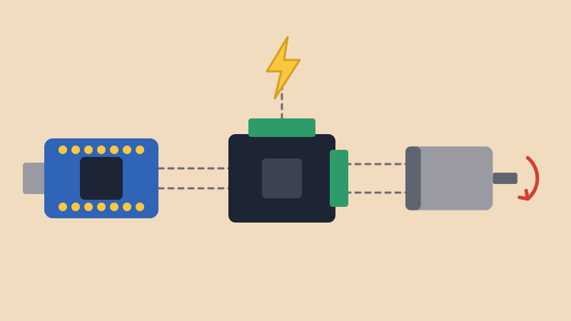
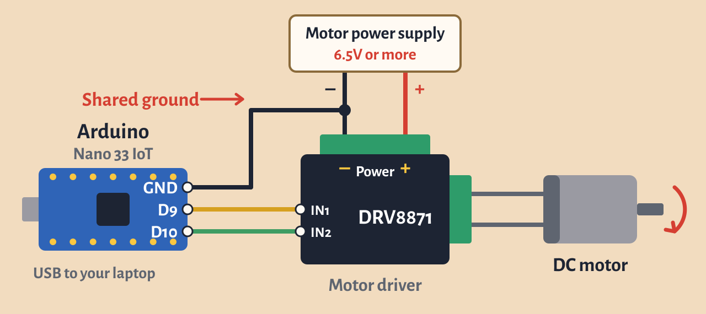

# DC Motors with the DRV8871 Driver

{alt="An Arduino connected to a motor driver board, which spins a DC motor. A separate power supply feeds the driver."}

## Intro

A [servo](../sweep/sweep.html) turns to an angle. A **DC motor** just keeps spinning, which is what you want for wheels, fans or anything that needs to keep turning.

A DC motor needs much more power than an Arduino pin can give, so we use a **motor driver**. The Arduino sends a small signal, and the driver uses it to switch a separate, stronger power supply on and off for the motor. It can also reverse the motor's direction.

This lesson uses the [Adafruit DRV8871](https://www.adafruit.com/product/3190). For a more complete reference, see the [Adafruit guide](https://learn.adafruit.com/adafruit-drv8871-brushed-dc-motor-driver-breakout) and the [DRV8871 datasheet](https://www.ti.com/lit/ds/symlink/drv8871.pdf).

## Materials

For this lesson, please collect the following:

- Arduino Nano 33 IoT and USB cable
- Adafruit DRV8871 motor driver
- DC motor
- A power supply for the motor, 6.5V or more
- A barrel jack to screw terminal adapter, if your power supply has a round plug
- Jumper wires and a small screwdriver

The driver's screw terminals come soldered on, but you need to solder on the header pins for IN1 and IN2. See the [Soldering Workshop](../../Workshops/Soldering_Workshop/soldering_workshop.html) if you need a refresher.

## Choosing a Motor and Power Supply

- **Voltage:** The driver needs **6.5V to 45V**, so it won't run from the USB. The breadboard power supply module won't work either, since it only gives 5V or 3.3V. Choose a supply that matches your motor: a 12V motor needs a 12V supply.
- **Low-voltage motors:** If your motor is rated below 6.5V, you can lower its average voltage with `analogWrite()`. For example, 170 out of 255 on a 9V supply averages about 6V. A motor rated for 6.5V or more is a better match, though.
- **Current:** Check your motor's **stall current**, the current it pulls when it can't turn. Your supply should be able to give at least that much. The 9V adapter in your kit gives 1A, so it is only enough for small motors. The driver limits the current to about 2A.

## Wiring



- Power supply **+** → driver's **+** Power terminal
- Power supply **–** → driver's **–** Power terminal
- Nano **GND** → driver's **–** Power terminal as well, so they share a ground
- Nano **D9** → driver's **IN1**
- Nano **D10** → driver's **IN2**
- Motor's two wires → driver's two motor terminals

The drawing puts the Nano's pins next to each other to keep the wires clear. On the real board they are in different places, so go by the labels printed on your Nano.

**Keep the motor's power away from the Nano.** Power the Nano from the USB, and don't connect the driver's **+** Power terminal to Vin or to any pin. The Nano's pins only take 3.3V. The one wire they share is the ground.

## How It Works

The two inputs decide what the motor does:

- **IN1 HIGH, IN2 LOW:** Forward
- **IN1 LOW, IN2 HIGH:** Reverse
- **Both LOW:** Coast to a stop. The driver also goes to sleep until you send it a signal again.
- **Both HIGH:** Brake to a quick stop

To control the speed, use `analogWrite()` on one input instead of `HIGH`. This is the same PWM we used in [Fade](../fade/fade.html), so pins 9 and 10 both work. The higher the number, the faster the motor spins.

## Example: Forward and Reverse

```arduino
int in1 = 9;   // PWM pin to the driver's IN1
int in2 = 10;  // PWM pin to the driver's IN2

void setup() {
  pinMode(in1, OUTPUT);
  pinMode(in2, OUTPUT);
}

void loop() {
  // forward at about half speed
  analogWrite(in1, 128);
  digitalWrite(in2, LOW);
  delay(2000);

  // coast to a stop
  digitalWrite(in1, LOW);
  digitalWrite(in2, LOW);
  delay(1000);

  // reverse at about half speed
  digitalWrite(in1, LOW);
  analogWrite(in2, 128);
  delay(2000);

  // coast to a stop
  digitalWrite(in1, LOW);
  digitalWrite(in2, LOW);
  delay(1000);
}
```

### Play Around

Try changing the `128` to see how the speed changes. What is the lowest number that gets your motor to start? Below that, it may just hum without turning.

## Example: Control the Speed with a Sensor

Connect a potentiometer or photoresistor to **A0**. The [Arduino Cheat Sheet](../cheat_sheet/cheat_sheet.html) has the wiring for both. Then use [map()](../map/map.html) to turn its reading into a speed:

```arduino
int in1 = 9;        // PWM pin to the driver's IN1
int in2 = 10;       // PWM pin to the driver's IN2
int sensorPin = A0;

void setup() {
  pinMode(in1, OUTPUT);
  pinMode(in2, OUTPUT);
  digitalWrite(in2, LOW);  // keep IN2 low so the motor only goes forward
}

void loop() {
  int reading = analogRead(sensorPin);
  int motorSpeed = map(reading, 0, 1023, 0, 255);
  analogWrite(in1, motorSpeed);
  delay(10);
}
```

## When Something Goes Wrong

- **The motor doesn't move:** Check that the Nano's GND is connected to the driver's **–** Power terminal, that the supply is on and gives at least 6.5V, and that the screw terminals are tight. Then try a higher speed number.
- **The motor stops when it has to work hard:** It may be pulling more current than the supply can give. The driver also shuts itself off to protect itself if it gets too much current, too hot or too little voltage. Try a stronger supply or a lighter load.
- **The motor spins the wrong way:** Swap its two wires, or swap IN1 and IN2 in your code.
