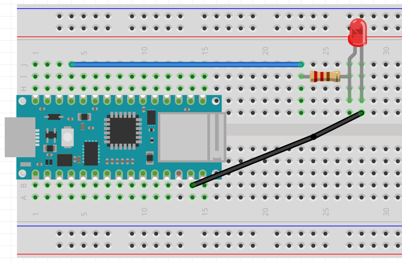
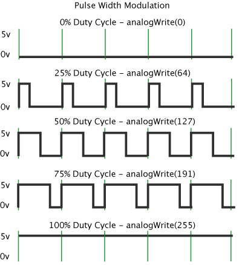
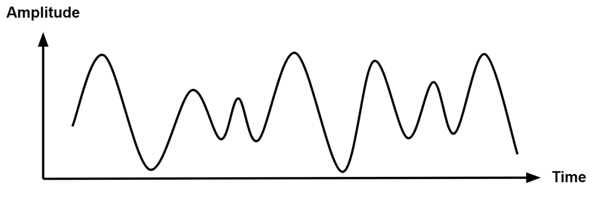
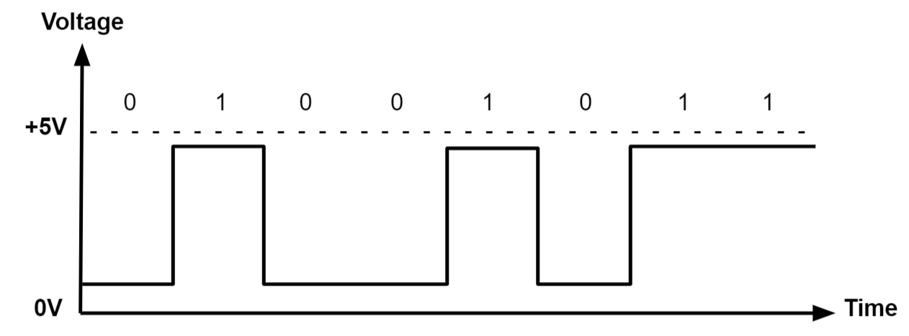
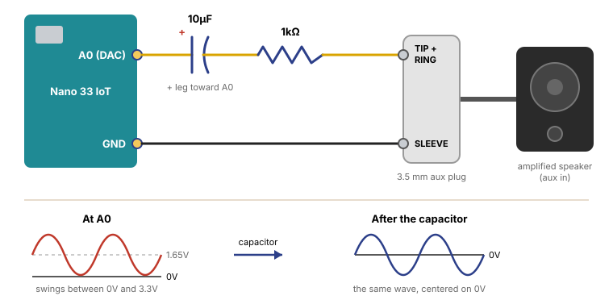

# Fade and Intro to PWM

## Intro

The official Arduino documentation is a more complete reference:

::: {.topics}

::: {.card type="external" title="Fade" thumb="../../../images/arduino_docs.svg" href="https://docs.arduino.cc/built-in-examples/basics/Fade/" tag="Docs"}
:::

::: {.card type="external" title="Basics of PWM" thumb="../../../images/arduino_docs.svg" href="https://docs.arduino.cc/learn/microcontrollers/analog-output/" tag="Docs"}
:::

:::

To open the example, go to:

**File** > **Examples** > **01.Basics** > **Fade**

### The Idea

The Fade example is one of the most basic examples for learning `analogWrite()`. Before, we used digital output (`digitalWrite()`) to power an LED with either 3.3V or 0V. With analog output, we can power things with anything in between 0V and 3.3V. So instead of just turning an LED fully on or fully off (2 possible states), we can change its brightness with 256 possible values, from 0 to 255 (8-bit resolution). This uses something called **Pulse Width Modulation** (PWM).

The sketch description says:

> This example shows how to fade an LED on pin 9 using the analogWrite() function.
>
> The analogWrite() function uses PWM, so if you want to change the pin you're using, be sure to use another PWM capable pin. On most Arduino, the PWM pins are identified with a "~" sign, like ~3, ~5, ~6, ~9, ~10 and ~11.

The Nano 33 IoT doesn't print the "~" on the board, so check the [pinout sheet](https://docs.arduino.cc/resources/pinouts/ABX00027-full-pinout.pdf) for the PWM pins. Pin 9 is one of them.

### The Circuit

The same LED circuit as in [Blink](../blink/blink.html): pin 9 → 220Ω resistor → LED (long leg) → LED (short leg) → GND.



## Pulse Width Modulation

According to the documentation:

> Pulse Width Modulation, or PWM, is a technique for getting analog results with digital means. Digital control is used to create a square wave, a signal switched between on and off.

{width=60% style="background-color: white"}

A PWM pin can still only do two things: 3.3V (on) or 0V (off). What PWM does is switch between them very fast, hundreds of times or more every second, in a repeating pattern called a **square wave**. One full on-and-off cycle is called the **period** (*T*), and the "on time" within each period is called the **pulse width**.

#### How does it "average out"?

The pin is never actually at 1.65V. It's always at 3.3V or 0V. The averaging happens in whatever is connected to it, because that thing can't react as fast as the pin is switching.

Imagine flicking a light switch on and off so fast that you can't see the flicker. If the light is on for half the time and off for the other half, the room looks half as bright. If it's on for only a quarter of the time, it looks a quarter as bright. That's PWM.

As numbers: say one period lasts 2 milliseconds, and the pin is on for 1 of them.

- For 1 ms the pin is at 3.3V, and for 1 ms it's at 0V.
- Averaged over the whole 2 ms: (3.3V × 1 ms + 0V × 1 ms) ÷ 2 ms = **1.65V**.

If it's on for 0.5 ms out of every 2 ms instead, the average is 3.3V × 0.5 ÷ 2 = **0.825V**. So by changing the pulse width, we change the average voltage, without the pin ever outputting anything other than 3.3V or 0V.

Different things do the averaging in different ways:

- **Your eyes:** an LED blinking hundreds of times a second just looks dimmer. Our eyes blend the flashes together.
- **A motor:** it's too heavy to start and stop that fast, so it spins at an in-between speed.
- **A multimeter:** in DC voltage mode it measures slowly, so on a PWM pin it shows the average (about 1.65V at 50%).
- **An oscilloscope** is fast enough to draw every on and off, so it shows the square wave and not the average. That's what we look at in the [oscilloscope section](#on-the-oscilloscope).

The percentage of time the signal is on is called the **duty cycle**. The average voltage is 3.3V × the duty cycle:

| Duty cycle | Code | Average voltage |
|---|---|---|
| 25% | `analogWrite(led, 64)` | 0.825V |
| 50% | `analogWrite(led, 127)` | 1.65V |
| 75% | `analogWrite(led, 191)` | 2.475V |

### Analog vs. Digital

Remember the difference between analog and digital signals:

**Analog:** a continuous signal.

{width=60% style="background-color: white"}

**Digital:** represents a signal with a sequence of discrete values, typically using binary code (0s and 1s).

{width=60% style="background-color: white"}

## Code Breakdown

### Declaring our Variables

```arduino
int led = 9;         // the PWM pin the LED is attached to
int brightness = 0;  // how bright the LED is
int fadeAmount = 5;  // how many points to fade the LED by
```

### The Setup Function

```arduino
void setup() {
  // declare pin 9 to be an output:
  pinMode(led, OUTPUT);
}
```

### The Loop Function

```arduino
void loop() {
  // set the brightness of pin 9:
  analogWrite(led, brightness);

  // change the brightness for next time through the loop:
  brightness = brightness + fadeAmount;

  // reverse the direction of the fading at the ends of the fade:
  if (brightness <= 0 || brightness >= 255) {
    fadeAmount = -fadeAmount;
  }
  // wait for 30 milliseconds to see the dimming effect
  delay(30);
}
```

Each time through the loop, `brightness` goes up by 5. When it reaches 255 (fully on), `fadeAmount` flips to -5 and the LED starts dimming. When it gets back to 0, it flips again.

## On the Oscilloscope

An oscilloscope draws voltage over time, so we can see the difference between the two ways of dimming an LED:

**Analog fade** (with a pressure sensor as a voltage divider): the line moves up and down smoothly. The voltage itself is changing.

**PWM fade** (with `analogWrite()`): the line is always either at 3.3V or at 0V. Only the width of the "on" pulses changes. The LED blinks too fast for our eyes to see, so it looks dimmer.

<details class="sy-details">
<summary>Demo Sketch: PWM vs. DAC (fade both at once)</summary>

Most Arduino pins can only fake an analog voltage with PWM. But pin **A0** on the Nano 33 IoT has a **DAC** (digital-to-analog converter) that outputs a real voltage between 0V and 3.3V. This sketch fades both at the same time, so you can compare them side by side:

- **Pin 9 (PWM):** LED → 220Ω resistor → GND. Oscilloscope channel 1 on pin 9.
- **Pin A0 (DAC):** oscilloscope channel 2 on A0, with no LED. An LED here would be dim, and it flattens the top of the wave at the LED's forward voltage.

Set `USE_SENSOR` to `true` to control both outputs with the pressure sensor (as a voltage divider on A1) instead of the automatic fade.

```arduino
// PWM vs. DAC: fade pin 9 with PWM and pin A0 with the DAC, at the same time.
// Probe pin 9 and pin A0 with the oscilloscope to compare them.

const int pwmPin = 9;      // PWM: switches between 0V and 3.3V very fast
const int dacPin = A0;     // DAC: a real voltage between 0V and 3.3V
const int sensorPin = A1;  // pressure sensor (voltage divider)

const bool USE_SENSOR = false;  // true = the sensor controls both outputs

int value = 0;       // 0-1023
int fadeAmount = 4;  // how much to change the value each step

void setup() {
  pinMode(pwmPin, OUTPUT);
  // use 10 bits (0-1023) for both outputs, the DAC's full resolution
  analogWriteResolution(10);
  Serial.begin(9600);
}

void loop() {
  if (USE_SENSOR) {
    value = analogRead(sensorPin);  // 0-1023
  } else {
    value = value + fadeAmount;
    if (value <= 0 || value >= 1023) {
      fadeAmount = -fadeAmount;
    }
    value = constrain(value, 0, 1023);
  }

  analogWrite(pwmPin, value);  // PWM
  analogWrite(dacPin, value);  // DAC

  Serial.println(value);  // also try the Serial Plotter
  delay(3);
}
```

On the scope, pin 9 is a square wave whose pulses get wider and narrower. Pin A0 rises and falls in straight lines: a slow triangle wave.

</details>

<details class="sy-details">
<summary>Demo Sketch: DAC Waveforms (square, sine, triangle, saw)</summary>

Because the DAC can output any voltage, it can draw any wave shape, fast enough to hear. This sketch plays a **square**, **sine**, **triangle** or **saw** wave on pin A0.

- **Switch waves:** press the button on pin 2 (wired like the [Button sketch](../button/button.html)), or type `1`, `2`, `3` or `4` in the Serial Monitor.
- **Change the pitch:** type `+` or `-` in the Serial Monitor (one semitone each). It starts at 220 Hz.
- **Oscilloscope:** probe A0.
- **Speakers:** see the wiring below.

```arduino
// DAC waveforms: square, sine, triangle and saw on pin A0.
// Press the button on pin 2, or type 1-4 in the Serial Monitor, to switch waves.
// Type + or - to change the pitch by a semitone.

const int dacPin = A0;
const int buttonPin = 2;

const char* waveNames[] = {"square", "sine", "triangle", "saw"};
int wave = 0;             // 0 = square, 1 = sine, 2 = triangle, 3 = saw
float frequency = 220.0;  // Hz

int sineTable[256];       // one cycle of a sine wave, precomputed (sin() is slow)
uint32_t phase = 0;       // position in the cycle: 0 to 2^32 is one full cycle
uint32_t phaseStep;       // how far the phase moves each microsecond
uint32_t lastMicros;
int lastButtonState = LOW;

void setup() {
  analogWriteResolution(10);  // DAC values 0-1023 (0-3.3V)
  pinMode(buttonPin, INPUT);
  Serial.begin(9600);

  for (int i = 0; i < 256; i++) {
    sineTable[i] = 511.5 + 511.5 * sin(2 * PI * i / 256.0);
  }
  setFrequency(frequency);
  setWave(0);
  lastMicros = micros();
}

void loop() {
  // move forward in the cycle by however much time has passed
  uint32_t now = micros();
  phase += (now - lastMicros) * phaseStep;
  lastMicros = now;

  int p = phase >> 22;  // position in the cycle as 0-1023
  int value;
  if (wave == 0) {
    value = (p < 512) ? 1023 : 0;                 // square: on half, off half
  } else if (wave == 1) {
    value = sineTable[phase >> 24];               // sine: look it up in the table
  } else if (wave == 2) {
    value = (p < 512) ? p * 2 : (1023 - p) * 2;   // triangle: up, then down
  } else {
    value = p;                                    // saw: up, then drop
  }
  analogWrite(dacPin, value);

  // the button switches to the next wave each time it's pressed
  int buttonState = digitalRead(buttonPin);
  if (buttonState == HIGH && lastButtonState == LOW) {
    setWave((wave + 1) % 4);
    delay(20);  // debounce
  }
  lastButtonState = buttonState;

  // keys typed in the Serial Monitor
  if (Serial.available()) {
    char c = Serial.read();
    if (c >= '1' && c <= '4') setWave(c - '1');
    if (c == '+') setFrequency(frequency * 1.059463);  // up a semitone
    if (c == '-') setFrequency(frequency / 1.059463);  // down a semitone
  }
}

void setWave(int w) {
  wave = w;
  Serial.print("wave: ");
  Serial.println(waveNames[wave]);
}

void setFrequency(float f) {
  frequency = f;
  phaseStep = frequency * 4294967296.0 / 1000000.0;
  Serial.print("frequency: ");
  Serial.print(frequency);
  Serial.println(" Hz");
}
```

<h5>Wiring for Speakers</h5>

A0 → 10µF capacitor (+ leg toward A0) → 1kΩ resistor → the **tip and ring** of an aux plug, and GND → the **sleeve**. The tip is the left channel and the ring is the right, so connecting both plays the sound in both speakers. Plug the other end into an amplified speaker (one with its own power and volume knob), and start with the volume low.

<a href="images/dac_audio_wiring.svg" target="_blank" title="Open the drawing full size"></a>

**Why the capacitor?** The DAC can only output voltages between 0V and 3.3V, so every wave it makes is centered on 1.65V instead of on 0V. That constant 1.65V is called a **DC offset**. Audio inputs expect a signal that swings above and below 0V, and the steady DC part can make the amplifier pop when you plug in, push the wave off-center so it distorts, or waste power. A capacitor blocks steady (DC) voltage but lets changing (AC) voltage through, so the wave comes out the same shape, centered on 0V. Many amplified speakers already have a capacitor on their input, so it often works without one, but it's the safe way to connect.

**Why the resistor?** It limits the current if something is shorted, and it turns the volume down a little: the DAC's 3.3V swing is louder than the line-level signal an aux input expects.

**Never connect a speaker directly to the pin.** A bare speaker has very low resistance (around 8Ω) and would try to pull far more current than the pin can give. It needs an amplifier.

</details>

### Why PWM and Not the DAC?

If the DAC makes a real voltage, why do we use PWM to dim LEDs?

**There's only one DAC.** On the Nano 33 IoT, only pin A0 has a DAC, and many Arduinos (like the Uno) have no DAC at all. PWM works on many pins, so you can dim several LEDs or control several motors at once.

**The DAC is weak.** It's made to output a signal, not to power things. It can only supply a small amount of current, so an LED on A0 stays dim, and a motor wouldn't move at all. A PWM pin is either fully on or fully off, so it gives the full current the pin can supply, just for part of the time.

**LEDs don't dim smoothly with voltage.** An LED stays completely off until the voltage reaches its forward voltage (around 1.8V–2V for a red LED), then gets bright quickly. Turning down the voltage gives you a small, uneven range of brightness. With PWM, the LED always gets the same voltage, and the brightness follows how long it's on, so the whole 0–255 range is usable.

**For LEDs and motors, the average is all that matters.** As explained in [How does it "average out"?](#how-does-it-average-out), our eyes and a motor's weight smooth out the switching, so PWM works just as well as a real voltage.

**When the DAC is the better choice:** when the shape of the voltage itself matters, like sound (the waveforms demo above), smooth control signals, or sending an analog voltage into another device. A PWM signal played through a speaker sounds buzzy, because you hear the fast on-off switching too.

## Further Material

### Video Tutorials

::: {.video-embed}
<iframe src="https://www.youtube.com/embed/TWGdfFVlroo" title="How To Create A PWM Signal Using The Arduino Uno" loading="lazy" allow="accelerometer; autoplay; clipboard-write; encrypted-media; gyroscope; picture-in-picture; web-share" referrerpolicy="strict-origin-when-cross-origin" allowfullscreen></iframe>

**How To Create A PWM Signal Using The Arduino Uno**  
Hamed Adefuwa. An intro to PWM on the Arduino Uno; the same ideas apply to the Nano 33 IoT.
:::

::: {.video-embed}
<iframe src="https://www.youtube.com/embed/X8dHbdhnGKY" title="Fading LED With Arduino in Tinkercad" loading="lazy" allow="accelerometer; autoplay; clipboard-write; encrypted-media; gyroscope; picture-in-picture; web-share" referrerpolicy="strict-origin-when-cross-origin" allowfullscreen></iframe>

**Fading LED With Arduino in Tinkercad**  
Autodesk Tinkercad. The Fade sketch built and simulated in Tinkercad.
:::
