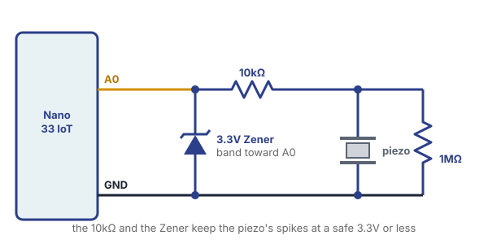

# Knock

## Intro

A [contact microphone](../microphones/microphones.html) is usually just a **piezo**, a thin disc that makes a small voltage whenever it's bent or shaken. Tape one to a table or a box, and the Arduino can tell when someone knocks on it.

The official Arduino documentation is a more complete reference:

::: {.topics}

::: {.card type="external" title="Knock" thumb="../../../images/arduino_docs.svg" href="https://docs.arduino.cc/built-in-examples/sensors/Knock/" tag="Docs"}
:::

:::

To open the example, go to:

**File** > **Examples** > **06.Sensors** > **Knock**

## Materials

For this lesson, please collect the following:

- Arduino Nano 33 IoT, USB cable and breadboard
- **Piezo disc with wires**
- **1MΩ resistor** (bands: brown, black, green)
- **10kΩ resistor** (bands: brown, black, orange)
- **3.3V Zener diode** (1N4728A): it looks like a regular diode, with a band on one end
- Masking tape and jumper wires

## Wiring

<blockquote class="warning">
<span class="uk-label" style="color:black; background:#fac100">Warning</span>
<p>The Arduino documentation only shows the 1MΩ resistor. Don't stop there: a hard knock can make a spike of <strong>much more than 3.3V</strong> for an instant, and the Nano 33 IoT's pins only take 3.3V. Never connect the piezo straight to A0. Always use the 10kΩ resistor and the Zener diode too.</p>
</blockquote>



With the **USB cable unplugged**, use three rows on the breadboard:

1. **Piezo row:** the piezo's **red** wire, one leg of the **1MΩ**, and one leg of the **10kΩ**.
2. **A0 row:** the other leg of the **10kΩ**, the **banded** end of the **Zener**, and a wire to **A0**.
3. **GND row:** the piezo's **black** wire, the other leg of the **1MΩ**, the other end of the **Zener**, and a wire to the Nano's **GND**.

What each part does:

- **1MΩ resistor:** lets the charge from each knock drain away, so the reading drops back to 0.
- **10kΩ resistor:** limits how much current a big spike can push toward the pin.
- **3.3V Zener diode:** if a spike goes above 3.3V, the extra flows to GND, so A0 stays safe. **The band goes toward A0.**

Then tape the piezo flat against a table or a box, with tape over the whole disc. It has to bend along with the surface, so it shouldn't hang loose.

## See Your Numbers

Before using the Knock example, let's see what the piezo actually does. Upload this sketch and open the **Serial Plotter**.

```arduino
void setup() {
  Serial.begin(9600);
}

void loop() {
  Serial.println(analogRead(A0));
}
```

Knock on the surface. Each knock makes a sharp spike, and the reading drops back down right after. Notice:

- How tall a soft knock is compared to a hard one.
- The small bumps when nobody is knocking. This is **noise**.
- How your other movements show up too, like typing or setting something down on the same table.

There's no `delay()` in this sketch on purpose. A spike only lasts a moment, and a delay could miss it.

## The Knock Example

Now upload the Knock example. Here's the code, without the long comment at the top of the file:

```arduino
// these constants won't change:
const int ledPin = 13;       // LED connected to digital pin 13
const int knockSensor = A0;  // the piezo is connected to analog pin 0
const int threshold = 100;   // threshold value to decide when the detected sound is a knock or not

// these variables will change:
int sensorReading = 0;  // variable to store the value read from the sensor pin
int ledState = LOW;     // variable used to store the last LED status, to toggle the light

void setup() {
  pinMode(ledPin, OUTPUT);  // declare the ledPin as as OUTPUT
  Serial.begin(9600);       // use the serial port
}

void loop() {
  // read the sensor and store it in the variable sensorReading:
  sensorReading = analogRead(knockSensor);

  // if the sensor reading is greater than the threshold:
  if (sensorReading >= threshold) {
    // toggle the status of the ledPin:
    ledState = !ledState;
    // update the LED pin itself:
    digitalWrite(ledPin, ledState);
    // send the string "Knock!" back to the computer, followed by newline
    Serial.println("Knock!");
    delay(100);  // delay to avoid overloading the serial port buffer
  }
}
```

Open the **Serial Monitor** and knock. Each knock should print `Knock!` and switch the Nano's built-in LED on or off.

### How It Works

- **`const int`** is a variable that can never change. Pin 13 is the Nano's built-in LED, so you don't need to wire one.
- **`threshold`** is the line between noise and a knock. A reading at or above 100 counts as a knock.
- **`ledState = !ledState;`** flips the state. The `!` means "not", so `LOW` becomes `HIGH` and `HIGH` becomes `LOW`.
- **`delay(100)`** waits a tenth of a second after each knock. This also helps keep one knock from counting more than once, since the surface keeps shaking for a moment after you hit it.

## Play Around

Change `threshold` using the numbers you saw in the Serial Plotter. It needs to be above the noise and below your softest knock. What happens at `20`? At `500`?

Then move the piezo. Try a table, a box, a door, a window or a piece of cardboard. Which one gives you the tallest spikes?

Now make a knock do something. All of these go inside the `if`, in place of the LED code or next to it:

- **Make a sound:** Connect a passive buzzer or STEMMA Speaker to pin 8, as in the [Buzzer lesson](../buzzer_speaker/buzzer_speaker.html), and add `tone(8, 440, 100);`. If the sound sets off another knock, you've made your own feedback loop, like *[Pendulum Music](../microphones/microphones.html)*. To stop it, move the speaker away from the surface or raise `threshold`.
- **Move something:** Switch a [servo](../sweep/sweep.html) between `0` and `180` on each knock. You can use the `ledState` variable to decide which one.
- **Press a key:** Follow the [Keyboard lesson](../Keyboard/Keyboard.html) and add `Keyboard.write(KEY_UP_ARROW);` to jump in the Dino game by knocking on the table. Get your `threshold` right first, because every false knock presses the key in whatever window is open, including your sketch.

Want to know **how hard** someone knocked, or how much time passed between knocks? The [Bouncing Ball Sensor](../../Workshops/Bouncing_Ball/bouncing_ball.html) workshop uses the same circuit to do both.

## When Something Goes Wrong

- **The Serial Plotter only shows 0.** Piezo wires are thin and can slip out of the breadboard, so check those first. Then check that the piezo is taped flat, and that the piezo row and the A0 row are connected through the 10kΩ resistor.
- **The readings never go above about 200, even for hard knocks.** The Zener is backwards. Its band must face the A0 row.
- **`Knock!` prints nonstop.** The 1MΩ resistor may be missing or in the wrong place: it goes from the piezo row to the GND row. If it's wired correctly, raise `threshold`.
- **One knock prints twice, or the LED seems to do nothing.** One knock is counting more than once, so the LED turns on and back off. Raise the `delay(100)` to `delay(200)`.
- **It triggers when nobody is knocking.** Footsteps and typing can shake the table too. Raise `threshold`, or move the piezo to something else.
