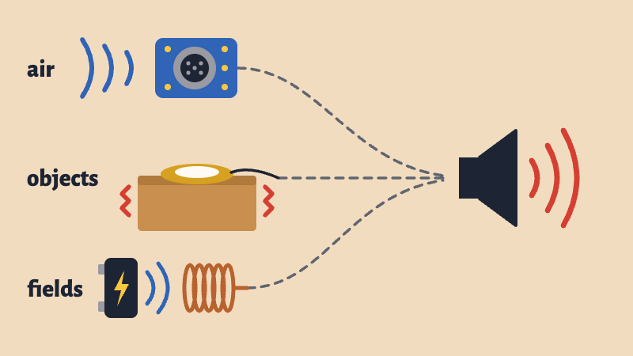

# Microphones

{alt="Three microphones wired to one speaker. An electret microphone hears waves in the air, a contact microphone taped to a box hears the box shake, and a coil hears the magnetic field around a charger."}

## Intro

A microphone turns something you can't see into a voltage. Send that voltage to an amplifier and a speaker, and you can hear it.

We'll plug three kinds into the same speaker. They all get wired almost the same way, but each one listens to something different:

- An **electret microphone** hears the air.
- A **contact microphone** hears the object it's touching.
- An **electromagnetic pickup** hears the magnetic fields around anything that uses electricity.

As you listen, think about your final project. What could it listen to?

## Set Up the Speaker

You don't need any code to listen. The Arduino is only giving power to the circuit, so we can hear exactly what each microphone hears.

<blockquote class="warning">
<span class="uk-label" style="color:black; background:#fac100">Warning</span>
<p>Turn the volume down before you plug anything in. The speaker has a small volume adjustment that you turn with a screwdriver, and feedback gets loud quickly.</p>
</blockquote>

Connect the [STEMMA Speaker](https://www.adafruit.com/product/3885). This part stays the same for all three microphones:

- **Red** (power) → Nano **3.3V**
- **Black** (ground) → Nano **GND**
- **White** (signal) → the microphone you're trying

## Electret Microphone: The Air

Sound is air moving. Inside an electret microphone is a very thin sheet that moves with the air, and that movement makes a very small voltage. It's so small that these microphones usually come on a board with an **amplifier**, which makes the voltage big enough to use.

Wire it up:

- **VCC** (or VDD) → Nano **3.3V**
- **GND** → Nano **GND**
- **OUT** → speaker's **white** wire

Talk into it or clap. Then move it slowly toward the speaker. Where does it start to howl?

The microphone hears everything in the room, including the speaker it's plugged into. When it gets too close, this happens:

1. The microphone hears the speaker.
2. The amplifier makes that sound bigger, and the speaker plays it.
3. The microphone hears that louder sound, and it goes around again.

This loop is called **feedback**. In a fraction of a second it grows into a howl, and it stops as soon as you move the microphone away.

## Feedback in Art

Feedback is usually a mistake that someone rushes to fix. Steve Reich used it on purpose. As you watch, ask: **what's in the loop?**

::: {.video-embed}
<iframe src="https://www.youtube.com/embed/dLaZ8LRfmkg" title="Steve Reich: Pendulum Music, by Maya Kawasaki and Shintaro Shibayama" loading="lazy" allow="accelerometer; autoplay; clipboard-write; encrypted-media; gyroscope; picture-in-picture; web-share" referrerpolicy="strict-origin-when-cross-origin" allowfullscreen></iframe>

**Steve Reich, *Pendulum Music* (1968)**  
This version is by Maya Kawasaki and Shintaro Shibayama. Reich got the idea while swinging a live microphone like a lasso and hearing it squeal as it passed a speaker. In the piece, microphones hang from their cables above speakers. The performers pull them back, let go, then sit and listen with the audience. Each microphone makes a burst of feedback every time it swings past its speaker, and the bursts drift in and out of time with each other. The piece ends after the microphones have stopped moving, when the performers pull the plug on the amplifiers.

At a 1969 performance at the Whitney Museum, the performers were the artists Richard Serra, Bruce Nauman and Michael Snow, and the composer James Tenney.

**The loop:** microphone, amplifier, speaker, air and back to the microphone. Nobody plays a note. The performers set up the system, and it plays itself.
:::

## Read the Electret with the Arduino

The Arduino can listen too. Take the microphone's **OUT** wire off the speaker and connect it to **A0**:

- **VCC** (or VDD) → Nano **3.3V**
- **GND** → Nano **GND**
- **OUT** → **A0**

Keep VCC on 3.3V. The microphone's output can swing as high as its power, and A0 only takes 3.3V.

A microphone's reading swings up and down around a middle value, so one reading doesn't tell you how loud it is. This sketch listens for 50 milliseconds and remembers the lowest and highest readings. The bigger the difference between them, the louder the sound. It's the same idea as the calibration in the [Light Theremin](../buzzer_speaker/buzzer_speaker.html).

```arduino
// Electret microphone: how loud is it?
// Wiring: VCC to 3.3V, GND to GND, OUT to A0

int micPin = A0;
int threshold = 100;   // loudness that turns on the LED (change this)

void setup() {
  Serial.begin(9600);
  pinMode(LED_BUILTIN, OUTPUT);
}

void loop() {
  int lowest = 1023;   // start high, so any reading will be lower
  int highest = 0;     // start low, so any reading will be higher

  // listen for 50 milliseconds, remembering the lowest and highest readings
  unsigned long start = millis();
  while (millis() - start < 50) {
    int reading = analogRead(micPin);
    if (reading < lowest) {
      lowest = reading;
    }
    if (reading > highest) {
      highest = reading;
    }
  }

  // the bigger the swing, the louder the sound
  int loudness = highest - lowest;
  Serial.println(loudness);

  if (loudness > threshold) {
    digitalWrite(LED_BUILTIN, HIGH);
  } else {
    digitalWrite(LED_BUILTIN, LOW);
  }
}
```

Upload it and open the **Serial Plotter**. Talk, clap and stay quiet, and watch the line. Then change `threshold` so it's above the noise in the room and below a clap. The built-in LED should come on when you clap.

Try making it do something:

- **Make a sound:** Connect a passive buzzer to pin 8 and use `map(loudness, 0, 500, 200, 2000)` to turn loudness into a pitch for `tone()`. The microphone will hear the buzzer too, so you've made your own feedback loop.
- **Move something:** Use `map()` the same way to turn loudness into an angle for a [servo](../sweep/sweep.html).

## Contact Microphone: The Object

A contact microphone is usually just a **piezo**, a thin disc that makes a small voltage whenever it's bent or shaken. It hears very little of the air. Instead, it hears the vibrations in whatever it's taped to.

Wire it up:

- Build the circuit from the [Knock](../knock/knock.html) lesson, with the 1MΩ resistor, the 10kΩ resistor and the Zener diode.
- Connect the speaker's **white** wire to the row that would go to A0.

Tape one to a table and you can hear knocks, scratches and footsteps. Tape one to a box, a window or a [doorstop spring](../../Workshops/Doorstop_Switch/doorstop_switch.html) and you hear the inside of that object, often with sounds you wouldn't notice with your ears. Tap it, scratch it and drag things across it.

Then hold the speaker against the object. Can you get feedback?

The Arduino can read a piezo too. That's what we do in the [Knock](../knock/knock.html) lesson.

## Laurie Anderson: The Handphone Table

::: {.video-embed}
<iframe src="https://www.youtube.com/embed/dElYX_yiyBQ" title="Laurie Anderson: The Handphone Table, Festival Archipel 2023" loading="lazy" allow="accelerometer; autoplay; clipboard-write; encrypted-media; gyroscope; picture-in-picture; web-share" referrerpolicy="strict-origin-when-cross-origin" allowfullscreen></iframe>

**Laurie Anderson, *The Handphone Table* (1978)**  
Shown here at Festival Archipel in Geneva in 2023. You sit at a table, put your elbows in the hollows on the tabletop and cover your ears with your hands. Then you hear sound through the bones of your arms. Anderson got the idea when she rested her head on her hands while using an electric typewriter.

**What's listening:** your own body. A contact microphone hears vibrations moving through an object. This piece runs that idea the other way, sending vibrations through a table and into your bones.
:::

## Electromagnetic Pickup: Fields

An electromagnetic pickup is a **coil** of wire. When the magnetic field near a coil changes, it makes a voltage in the wire. Chargers, screens, motors and lights all make changing magnetic fields as they run. You can't hear those fields, but a coil and an amplifier turn them into sound.

A [speaker](../../Blog/CustomSpeakerWorkshop/CustomSpeakerWorkshop.html) is the same idea running backward: a voltage in its coil makes it move. Guitar pickups use coils too.

Any coil of wire can do this, and the more turns it has, the more it hears. A **telephone pickup coil** is a ready-made one with a lot of turns, made for recording phone calls. We don't have enough pickups for everyone, so I'll demonstrate this one with a coil of wire.

Wire it up:

- One end of the coil → speaker's **white** wire
- Other end of the coil → Nano **GND** (it doesn't matter which end goes where)

If the wire has a clear coating, like magnet wire, sand the ends first so they make contact.

A coil makes a very small voltage, so this one needs more volume than the other two. Start by moving a magnet near the coil. The moving magnet changes the field, so you should hear a thump. Then hold the coil close to a phone charger, a laptop or a screen, and move it around. The sound can change a lot in just a few centimeters. Then bring it near the speaker itself.

Only hold the coil near the outside of things. It doesn't need to touch anything, so never open a device or touch bare wires.

Coils can make feedback too. Here's *Pendulum Music* again, with coils swinging instead of microphones:

::: {.video-embed}
<iframe src="https://www.youtube.com/embed/1KvU7vxKFcA" title="Steve Reich: Pendulum Music (DIY), by Tero Parviainen" loading="lazy" allow="accelerometer; autoplay; clipboard-write; encrypted-media; gyroscope; picture-in-picture; web-share" referrerpolicy="strict-origin-when-cross-origin" allowfullscreen></iframe>

**Tero Parviainen, *Pendulum Music* (DIY)**  
Made with two telephone pickup coils and two small battery-powered guitar amps.

**The loop:** coil, amplifier, the speaker's magnetic field and back to the coil. A coil can't really hear the air, so this loop runs through magnetic fields instead of sound.
:::

## Christina Kubisch: Electrical Walks

::: {.video-embed}
<iframe src="https://www.youtube.com/embed/k2Yjfdnbtgw" title="Christina Kubisch: Discovering new sounds" loading="lazy" allow="accelerometer; autoplay; clipboard-write; encrypted-media; gyroscope; picture-in-picture; web-share" referrerpolicy="strict-origin-when-cross-origin" allowfullscreen></iframe>

**Christina Kubisch, *[Electrical Walks](https://christinakubisch.de/electrical-walks){target="_blank"}* (since 2003)**  
Kubisch has worked with electromagnetic induction since the late 1970s, and in 2003 she took it out into the city. You borrow a pair of headphones with coils built in, take a map and start walking. You hear the fields around you: lights, anti-theft gates, ATMs, surveillance cameras, neon signs and transit lines. In this video from the San Francisco Museum of Modern Art, she talks about how she discovered electromagnetic induction.

**What's listening:** coils in the headphones. It isn't a recording. You're hearing the fields around you as you walk through them.
:::

::: {.video-embed}
<iframe src="https://player.vimeo.com/video/54846163" title="Christina Kubisch: Electrical Walks, an introduction" loading="lazy" allow="autoplay; fullscreen; picture-in-picture" allowfullscreen></iframe>

**An introduction to *Electrical Walks* (about 11 minutes)**  
Kubisch's own introduction to the series.
:::

**It happened here.** In 2007, Kubisch brought *Electrical Walks* to the Loop, right next to our campus, with Chicago's Experimental Sound Studio. You can still see the [brochure and map](https://electricalwalks.org/maps/2007/14_Chicago/Chicago_brochure-v1e.pdf){target="_blank"}. Its advice also works for your own pickup: "Walk slowly, and sometimes just stop and turn your head around – electromagnetic fields can vary greatly within very short distances."

**Listen for yourself.** The project's site has an [archive of electromagnetic sounds](https://electricalwalks.org/electromagnetic-sounds-archive/){target="_blank"} and virtual walks through [Oslo](https://electricalwalks.org/virtual-walk-oslo/){target="_blank"} and [Tbilisi](https://electricalwalks.org/virtual-walk-tbilisi/){target="_blank"}.

## Next

In the [Knock](../knock/knock.html) lesson, we'll connect a contact microphone to the Arduino, so your code can respond when someone knocks on something.
