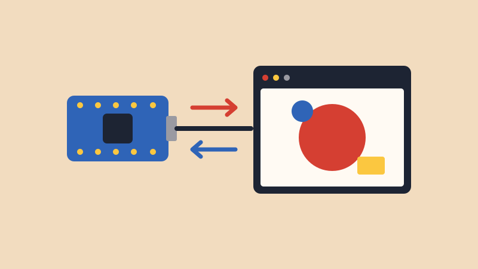

# p5.js Bridge

{alt="An Arduino and a browser window running a p5.js sketch, connected by a USB cable with arrows going both ways."}

## Intro

[p5.js](https://p5js.org/){target="_blank"} is a way to draw and make interactive things with code in your browser. A p5.js sketch looks a lot like an Arduino sketch: `setup()` runs once, and `draw()` runs over and over, like `loop()`.

Your Arduino and a p5.js sketch can talk to each other through the USB cable. This is the same **serial** connection the Serial Monitor uses, so your sensors can control what's on screen, and what's on screen can control your Arduino.

We'll use a library called [p5.webserial](https://github.com/gohai/p5.webserial){target="_blank"}, which handles the connection for you.

## Materials

- Arduino Nano 33 IoT and USB cable
- Chrome or Edge
- A potentiometer or photoresistor on A0, wired as in the [Arduino Cheat Sheet](../cheat_sheet/cheat_sheet.html)

## Set Up the p5.js Web Editor

1. Go to the [p5.js Web Editor](https://editor.p5js.org/){target="_blank"}. You don't need an account to try it, but you need one to save your work.
2. Click the **>** arrow next to the file name to see your files, then open **index.html**.
3. Paste this line right after the line that loads p5.js (it ends in `p5.js`):

```html
<script src="https://unpkg.com/@gohai/p5.webserial@1/libraries/p5.webserial.js"></script>
```

4. Go back to **sketch.js**. You'll paste each p5.js sketch below in there.

<blockquote class="warning">
<span class="uk-label" style="color:black; background:#fac100">Warning</span>
<p><strong>Close the Serial Monitor and Serial Plotter</strong> before you connect. Only one program can use the board at a time. To upload a new Arduino sketch, stop your p5.js sketch first.</p>
</blockquote>

## Part 1: Arduino to p5.js

Let's make a circle grow and shrink with your sensor.

**Arduino:** this sends a reading about 50 times a second, as a line of text.

```arduino
void setup() {
  Serial.begin(9600);
}

void loop() {
  Serial.println(analogRead(A0));
  delay(20);
}
```

**p5.js:**

```javascript
let port;
let reading = 0;

function setup() {
  createCanvas(400, 400);
  port = createSerial();

  // browsers only let you choose a board after you click something
  let button = createButton("Connect Arduino");
  button.mousePressed(connectArduino);
}

function connectArduino() {
  if (!port.opened()) {
    port.open("Arduino", 9600);
  }
}

function draw() {
  background(240);

  // get one line of text from the Arduino, if a whole line has arrived
  let message = port.readUntil("\n");
  if (message.length > 0) {
    reading = Number(message);
  }

  let size = map(reading, 0, 1023, 10, 380);
  circle(width / 2, height / 2, size);
}
```

Click the play button, then **Connect Arduino**. Choose your board in the list and click **Connect**. Now turn the potentiometer, or cover the photoresistor.

- **`port.readUntil("\n")`** gives you one line of text. `Serial.println()` ends each line with `\n`, so you get one reading at a time. It gives you empty text if no whole line has arrived yet.
- **`Number(message)`** turns the text `"512"` into the number `512`.
- **`map()`** works just like it does on the Arduino.

## Part 2: p5.js to Arduino

Now let's go the other way: clicking in the browser turns on the Arduino's built-in LED.

**Arduino:** this is the same `Serial.read()` from the [Keyboard](../Keyboard/Keyboard.html) lesson.

```arduino
void setup() {
  Serial.begin(9600);
  pinMode(LED_BUILTIN, OUTPUT);
}

void loop() {
  if (Serial.available() > 0) {
    char letter = Serial.read();

    if (letter == 'A') {
      digitalWrite(LED_BUILTIN, HIGH);
    }
    if (letter == 'B') {
      digitalWrite(LED_BUILTIN, LOW);
    }
  }
}
```

**p5.js:**

```javascript
let port;
let ledOn = false;

function setup() {
  let canvas = createCanvas(400, 400);
  canvas.mousePressed(toggleLed);
  port = createSerial();

  let button = createButton("Connect Arduino");
  button.mousePressed(connectArduino);
}

function connectArduino() {
  if (!port.opened()) {
    port.open("Arduino", 9600);
  }
}

function toggleLed() {
  if (!port.opened()) {
    return;
  }
  ledOn = !ledOn;
  if (ledOn) {
    port.write("A");
  } else {
    port.write("B");
  }
}

function draw() {
  if (ledOn) {
    background(251, 199, 64);
  } else {
    background(29, 36, 51);
  }
}
```

Connect, then click on the canvas. The canvas and the LED should change together.

## Part 3: Sending Several Numbers

To send more than one number, put commas between them on one line. Your board's built-in accelerometer is a good example, because it has three numbers and needs no wiring. Install **Arduino_LSM6DS3** from the Library Manager if you don't have it.

**Arduino:**

```arduino
#include <Arduino_LSM6DS3.h>

void setup() {
  Serial.begin(9600);
  IMU.begin();
}

void loop() {
  float x, y, z;

  if (IMU.accelerationAvailable()) {
    IMU.readAcceleration(x, y, z);
    Serial.print(x);
    Serial.print(",");
    Serial.print(y);
    Serial.print(",");
    Serial.println(z);
  }

  delay(20);
}
```

**p5.js:** tilting the board moves the circle.

```javascript
let port;
let tiltX = 0;
let tiltY = 0;

function setup() {
  createCanvas(400, 400);
  port = createSerial();

  let button = createButton("Connect Arduino");
  button.mousePressed(connectArduino);
}

function connectArduino() {
  if (!port.opened()) {
    port.open("Arduino", 9600);
  }
}

function draw() {
  background(240);

  let message = port.readUntil("\n");
  if (message.length > 0) {
    // "0.12,-0.34,0.98" becomes three separate pieces
    let parts = message.split(",");
    tiltX = Number(parts[0]);
    tiltY = Number(parts[1]);
  }

  let circleX = map(tiltY, -1, 1, 0, width);
  let circleY = map(tiltX, -1, 1, 0, height);
  circle(circleX, circleY, 60);
}
```

If the circle moves the wrong way, swap the last two numbers in that `map()`, like `map(tiltY, -1, 1, width, 0)`.

## Part 4: Your Own Teachable Machine Sketch

The [Teachable Machine](../teachable_machine/teachable_machine.html) tutorial has a page that does this for you. To build your own, you can use your model in a p5.js sketch with another library called [ml5.js](https://ml5js.org/){target="_blank"}. Follow that tutorial first to train your model and get its link.

In **index.html**, add ml5.js along with p5.webserial:

```html
<script src="https://unpkg.com/ml5@1.4.0/dist/ml5.min.js"></script>
```

**Arduino:** use the same sketch as in Part 2.

**p5.js:** change `modelLink` to your link, and change `"Class 1"` to the name of your own class.

```javascript
let modelLink = "https://teachablemachine.withgoogle.com/models/YOUR_MODEL/";

let port;
let video;
let label = "Loading your model...";
let lastLabel = "";

async function setup() {
  createCanvas(320, 280);
  video = createCapture(VIDEO, { flipped: true });
  video.size(320, 240);
  video.hide();

  port = createSerial();
  let button = createButton("Connect Arduino");
  button.mousePressed(connectArduino);

  // flipped: Teachable Machine mirrors the webcam when you train
  let classifier = await ml5.imageClassifier(modelLink + "model.json", { flipped: true });
  classifier.classifyStart(video, gotResult);
}

function connectArduino() {
  if (!port.opened()) {
    port.open("Arduino", 9600);
  }
}

// this runs each time the model has a new answer
function gotResult(results) {
  label = results[0].label;

  // only send a letter when the answer changes
  if (label !== lastLabel && port.opened()) {
    if (label === "Class 1") {
      port.write("A");
    } else {
      port.write("B");
    }
    lastLabel = label;
  }
}

function draw() {
  background(255);
  image(video, 0, 0, 320, 240);
  textSize(24);
  text(label, 10, 270);
}
```

`results` is a list of every class, with the most likely one first. Each one has a `label` and a `confidence` from 0 to 1. To only trust answers the model is sure about, check `results[0].confidence` too.

## When Something Goes Wrong

- **`createSerial is not defined`.** The p5.webserial line is missing from **index.html**, or it's above the line that loads p5.js.
- **`ml5 is not defined`.** The ml5.js line is missing from **index.html**.
- **The list of boards is empty.** Check the USB cable, since some only charge, and use Chrome or Edge.
- **It won't connect, or nothing arrives.** Close the Serial Monitor and Serial Plotter. Then stop your p5.js sketch, play it again and reconnect.
- **The Arduino IDE can't upload.** Stop your p5.js sketch first, because it's holding the connection.
- **The circle doesn't change.** Open the Serial Monitor (with your p5.js sketch stopped) and check that the Arduino is sending numbers.
- **You're using a different version of p5.js.** The Web Editor uses p5.js 2 by default. These sketches were tested with p5.js 2.3 and 1.11, so either one should work.
