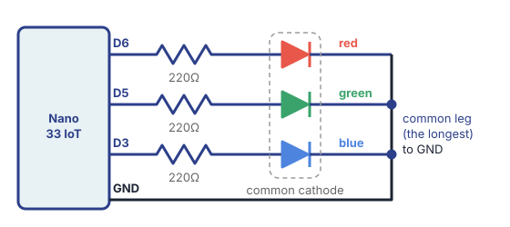
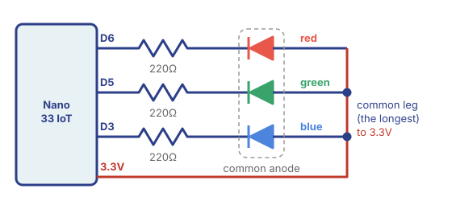
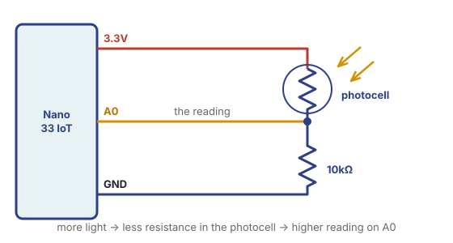

<style>
  /* show only the version for the LED picked below (common cathode by default) */
  html:not([data-led="anode"]) .led-anode,
  html[data-led="anode"] .led-cathode {
    display: none;
  }
  .led-picker {
    display: flex;
    flex-wrap: wrap;
    align-items: center;
    gap: 8px;
    margin: 1em 0;
  }
  .led-picker span {
    font-weight: 700;
    margin-right: 4px;
  }
  .led-picker button {
    font: inherit;
    padding: 8px 16px;
    border-radius: 999px;
    border: 2px solid var(--blue);
    background: var(--paper);
    color: var(--blue);
    cursor: pointer;
  }
  .led-picker button[aria-pressed="true"] {
    background: var(--blue);
    color: var(--paper);
  }
  .led-diagrams {
    display: grid;
    gap: 20px;
    max-width: 560px;
  }
  .led-diagrams p {
    margin: 0.2em 0 0;
  }
</style>

# RGB LED


## Summary

An **RGB LED** is three LEDs in one package: a **red**, a **green** and a **blue** one. By turning each one on, off, or somewhere in between, we can mix almost any color, the same way a screen mixes red, green and blue pixels.

We'll build up in four small sketches:

1. **Blink Colors:** cycle through the colors you can make with each color fully on or off.
2. **Fade RGB:** each color fades up and down with `analogWrite()`, each at its own speed.
3. **Potentiometer RGB:** a knob mixes the colors.
4. **Photocell RGB:** the light in the room mixes the colors. Next, we'll use this same photocell to play the [buzzer](../buzzer_speaker/buzzer_speaker.html).

For more diagrams and videos, see the Makeability Lab's [RGB LED](https://makeabilitylab.github.io/physcomp/arduino/rgb-led.html) lesson.

## Materials

- Arduino Nano 33 IoT and USB cable
- Breadboard
- RGB LED
- Three 220Ω resistors (bands: red, red, brown)
- Potentiometer
- Photoresistor (photocell) and a 10kΩ resistor (bands: brown, black, orange)
- Jumper wires

## Two Kinds of RGB LED

An RGB LED has **four legs**: one for each color, plus one **common** leg shared by all three. The common leg is the **longest** one. Usually the order is: red, common, green, blue.

There are two kinds, and they look exactly the same. The difference is where the common leg goes:

- **Common cathode:** the common leg goes to **GND**. Current flows **out of** the Arduino's pin, through the LED, to GND. This works just like the regular LEDs we've used so far: `HIGH` turns a color on.
- **Common anode:** the common leg goes to **3.3V**. Current flows from 3.3V, through the LED, and **into** the Arduino's pin. Everything is flipped: `LOW` turns a color on.

<div class="led-diagrams">
<div>

<p>**Common cathode:** common leg to **GND**</p>
</div>
<div>

<p>**Common anode:** common leg to **3.3V**</p>
</div>
</div>

Look at which way the LED symbols point: the triangle points the way the current flows. In common cathode, it flows from the pins toward GND. In common anode, it flows from 3.3V toward the pins.

### Which One Do I Have?

You can test it without any code, using the Arduino only for power:

1. Put the LED in the breadboard, each leg in its own row.
2. Connect the **longest leg** to **GND**, and the **red leg** through a **220Ω resistor** to **3.3V**.
3. If red lights up, you have a **common cathode** LED.
4. If not, swap them: longest leg to **3.3V**, and the red leg through the resistor to **GND**. If red lights up now, you have a **common anode** LED.

### Pick Your LED

Choose the kind you have, and the wiring and code below will change to match it. This page remembers your choice.

<div class="led-picker" role="group" aria-label="Which RGB LED do you have?">
<span>My RGB LED is:</span>
<button type="button" data-led="cathode" aria-pressed="true">Common cathode</button>
<button type="button" data-led="anode" aria-pressed="false">Common anode</button>
</div>

## Wiring the RGB LED


Each color leg gets its **own 220Ω resistor**, and its own pin. We use pins **6**, **5** and **3** because they can do PWM (`analogWrite()`), which we need for fading and mixing.

::: {.led-anode}
- **Longest leg** → **3.3V**
- **Red** leg → 220Ω resistor → **pin 6**
- **Green** leg → 220Ω resistor → **pin 5**
- **Blue** leg → 220Ω resistor → **pin 3**


:::

::: {.led-cathode}
- **Longest leg** → **GND**
- **Red** leg → 220Ω resistor → **pin 6**
- **Green** leg → 220Ω resistor → **pin 5**
- **Blue** leg → 220Ω resistor → **pin 3**


:::

Bend the legs apart a little and put each one in its **own row** of the breadboard, then add the resistors and wires to those rows. Keep this wiring for all four sketches.

<blockquote class="info">
<span class="uk-label">Note</span>
<p><strong>A note about 3.3V:</strong> green and blue LEDs need more voltage to light up than red ones. The Nano 33 IoT only gives 3.3V, so green and blue may look <strong>dimmer</strong> than red, and mixed colors may lean red.</p>
</blockquote>

## 1. Blink Colors

| | Common cathode | Common anode |
|---|---|---|
| Turn a color **on** | `digitalWrite(pin, HIGH)` | `digitalWrite(pin, LOW)` |
| Turn a color **off** | `digitalWrite(pin, LOW)` | `digitalWrite(pin, HIGH)` |
| **Full** brightness | `analogWrite(pin, 255)` | `analogWrite(pin, 0)` |
| **Off** | `analogWrite(pin, 0)` | `analogWrite(pin, 255)` |

With each color either fully **on** or fully **off**, we can make 7 colors: red, green and blue, and the mixes yellow, cyan, magenta and white. This sketch shows each one for a second, like the Blink sketch with three LEDs.

::: {.led-anode}
*Showing the code for a **common anode** LED. [Switch](#pick-your-led)*
:::

::: {.led-cathode}
*Showing the code for a **common cathode** LED. [Switch](#pick-your-led)*
:::

::: {.led-anode}
```arduino
// Blink Colors: show each color for one second.
// Our RGB LED is common anode: LOW turns a color ON, HIGH turns it OFF.

int redPin = 6;
int greenPin = 5;
int bluePin = 3;

void setup() {
  pinMode(redPin, OUTPUT);
  pinMode(greenPin, OUTPUT);
  pinMode(bluePin, OUTPUT);
}

void loop() {
  // red
  digitalWrite(redPin, LOW);
  digitalWrite(greenPin, HIGH);
  digitalWrite(bluePin, HIGH);
  delay(1000);

  // green
  digitalWrite(redPin, HIGH);
  digitalWrite(greenPin, LOW);
  digitalWrite(bluePin, HIGH);
  delay(1000);

  // blue
  digitalWrite(redPin, HIGH);
  digitalWrite(greenPin, HIGH);
  digitalWrite(bluePin, LOW);
  delay(1000);

  // yellow (red + green)
  digitalWrite(redPin, LOW);
  digitalWrite(greenPin, LOW);
  digitalWrite(bluePin, HIGH);
  delay(1000);

  // cyan (green + blue)
  digitalWrite(redPin, HIGH);
  digitalWrite(greenPin, LOW);
  digitalWrite(bluePin, LOW);
  delay(1000);

  // magenta (red + blue)
  digitalWrite(redPin, LOW);
  digitalWrite(greenPin, HIGH);
  digitalWrite(bluePin, LOW);
  delay(1000);

  // white (all three)
  digitalWrite(redPin, LOW);
  digitalWrite(greenPin, LOW);
  digitalWrite(bluePin, LOW);
  delay(1000);
}
```
:::

::: {.led-cathode}
```arduino
// Blink Colors: show each color for one second.
// Our RGB LED is common cathode: HIGH turns a color ON, LOW turns it OFF.

int redPin = 6;
int greenPin = 5;
int bluePin = 3;

void setup() {
  pinMode(redPin, OUTPUT);
  pinMode(greenPin, OUTPUT);
  pinMode(bluePin, OUTPUT);
}

void loop() {
  // red
  digitalWrite(redPin, HIGH);
  digitalWrite(greenPin, LOW);
  digitalWrite(bluePin, LOW);
  delay(1000);

  // green
  digitalWrite(redPin, LOW);
  digitalWrite(greenPin, HIGH);
  digitalWrite(bluePin, LOW);
  delay(1000);

  // blue
  digitalWrite(redPin, LOW);
  digitalWrite(greenPin, LOW);
  digitalWrite(bluePin, HIGH);
  delay(1000);

  // yellow (red + green)
  digitalWrite(redPin, HIGH);
  digitalWrite(greenPin, HIGH);
  digitalWrite(bluePin, LOW);
  delay(1000);

  // cyan (green + blue)
  digitalWrite(redPin, LOW);
  digitalWrite(greenPin, HIGH);
  digitalWrite(bluePin, HIGH);
  delay(1000);

  // magenta (red + blue)
  digitalWrite(redPin, HIGH);
  digitalWrite(greenPin, LOW);
  digitalWrite(bluePin, HIGH);
  delay(1000);

  // white (all three)
  digitalWrite(redPin, HIGH);
  digitalWrite(greenPin, HIGH);
  digitalWrite(bluePin, HIGH);
  delay(1000);
}
```
:::

Each color takes **three** `digitalWrite()` lines, one for each leg, and then a `delay()`.

::: {.led-anode}
Remember that with a common anode LED, **LOW** means on. So for red, the red pin is `LOW` and the other two are `HIGH`.
:::

**Try it:** add your own color to the sequence, change the order, or make the `delay()` shorter to flash through them faster.

## 2. Fade RGB

This is Monday's **Fade** sketch, three times: one `brightness` and one `fadeAmount` for each color. Each color fades by a different amount (1, 3 and 5), so they fade at **different speeds**, drift in and out of step, and the mix keeps changing.

::: {.led-anode}
*Showing the code for a **common anode** LED. [Switch](#pick-your-led)*
:::

::: {.led-cathode}
*Showing the code for a **common cathode** LED. [Switch](#pick-your-led)*
:::

::: {.led-anode}
```arduino
// Fade RGB: the Fade sketch, three times. Each color fades up and down
// at its own speed, so the mix keeps changing.

int redPin = 6;
int greenPin = 5;
int bluePin = 3;

int redBrightness = 0;
int greenBrightness = 0;
int blueBrightness = 0;

// each color fades by a different amount, so each one has its own speed
int redFadeAmount = 1;    // slow
int greenFadeAmount = 3;  // medium
int blueFadeAmount = 5;   // fast

void setup() {
  pinMode(redPin, OUTPUT);
  pinMode(greenPin, OUTPUT);
  pinMode(bluePin, OUTPUT);
}

void loop() {
  // common anode: 255 is OFF and 0 is full brightness,
  // so we send 255 minus the brightness
  analogWrite(redPin, 255 - redBrightness);
  analogWrite(greenPin, 255 - greenBrightness);
  analogWrite(bluePin, 255 - blueBrightness);

  redBrightness = redBrightness + redFadeAmount;
  greenBrightness = greenBrightness + greenFadeAmount;
  blueBrightness = blueBrightness + blueFadeAmount;

  // reverse the direction of each fade at the ends
  if (redBrightness <= 0 || redBrightness >= 255) {
    redFadeAmount = -redFadeAmount;
  }
  if (greenBrightness <= 0 || greenBrightness >= 255) {
    greenFadeAmount = -greenFadeAmount;
  }
  if (blueBrightness <= 0 || blueBrightness >= 255) {
    blueFadeAmount = -blueFadeAmount;
  }

  delay(20);
}
```
:::

::: {.led-cathode}
```arduino
// Fade RGB: the Fade sketch, three times. Each color fades up and down
// at its own speed, so the mix keeps changing.

int redPin = 6;
int greenPin = 5;
int bluePin = 3;

int redBrightness = 0;
int greenBrightness = 0;
int blueBrightness = 0;

// each color fades by a different amount, so each one has its own speed
int redFadeAmount = 1;    // slow
int greenFadeAmount = 3;  // medium
int blueFadeAmount = 5;   // fast

void setup() {
  pinMode(redPin, OUTPUT);
  pinMode(greenPin, OUTPUT);
  pinMode(bluePin, OUTPUT);
}

void loop() {
  analogWrite(redPin, redBrightness);
  analogWrite(greenPin, greenBrightness);
  analogWrite(bluePin, blueBrightness);

  redBrightness = redBrightness + redFadeAmount;
  greenBrightness = greenBrightness + greenFadeAmount;
  blueBrightness = blueBrightness + blueFadeAmount;

  // reverse the direction of each fade at the ends
  if (redBrightness <= 0 || redBrightness >= 255) {
    redFadeAmount = -redFadeAmount;
  }
  if (greenBrightness <= 0 || greenBrightness >= 255) {
    greenFadeAmount = -greenFadeAmount;
  }
  if (blueBrightness <= 0 || blueBrightness >= 255) {
    blueFadeAmount = -blueFadeAmount;
  }

  delay(20);
}
```
:::

::: {.led-anode}
Because the LED is common anode, we send `255 - redBrightness`: when `redBrightness` is 255 (full), we send `255 - 255 = 0`, which is full brightness for a common anode LED.
:::

**Try it:**

- Change the three `fadeAmount` values. (Keep them numbers that divide evenly into 255, like 1, 3, 5, 15 or 17, so each fade lands exactly on 0 and 255.)
- Change `delay(20)` to make everything faster or slower.

## 3. Potentiometer RGB

Now **you** control the mix. As you turn the knob, red fades out while blue fades in, passing through purple in the middle.

**Add the potentiometer:** one outer leg → **3.3V**, the other outer leg → **GND**, the middle leg → **A0**.

::: {.led-anode}
*Showing the code for a **common anode** LED. [Switch](#pick-your-led)*
:::

::: {.led-cathode}
*Showing the code for a **common cathode** LED. [Switch](#pick-your-led)*
:::

::: {.led-anode}
```arduino
// Potentiometer RGB: turn the knob to go from red, through purple, to blue.

int redPin = 6;
int greenPin = 5;
int bluePin = 3;
int potPin = A0;

void setup() {
  pinMode(redPin, OUTPUT);
  pinMode(greenPin, OUTPUT);
  pinMode(bluePin, OUTPUT);
  Serial.begin(9600);
}

void loop() {
  int potValue = analogRead(potPin);  // 0-1023
  Serial.println(potValue);

  // as the knob turns, red goes down while blue goes up
  int redBrightness = map(potValue, 0, 1023, 255, 0);
  int blueBrightness = map(potValue, 0, 1023, 0, 255);

  // common anode: send 255 minus the brightness
  analogWrite(redPin, 255 - redBrightness);
  analogWrite(greenPin, 255);  // green stays off
  analogWrite(bluePin, 255 - blueBrightness);

  delay(10);
}
```
:::

::: {.led-cathode}
```arduino
// Potentiometer RGB: turn the knob to go from red, through purple, to blue.

int redPin = 6;
int greenPin = 5;
int bluePin = 3;
int potPin = A0;

void setup() {
  pinMode(redPin, OUTPUT);
  pinMode(greenPin, OUTPUT);
  pinMode(bluePin, OUTPUT);
  Serial.begin(9600);
}

void loop() {
  int potValue = analogRead(potPin);  // 0-1023
  Serial.println(potValue);

  // as the knob turns, red goes down while blue goes up
  int redBrightness = map(potValue, 0, 1023, 255, 0);
  int blueBrightness = map(potValue, 0, 1023, 0, 255);

  analogWrite(redPin, redBrightness);
  analogWrite(greenPin, 0);    // green stays off
  analogWrite(bluePin, blueBrightness);

  delay(10);
}
```
:::

**New function: [`map()`](../map/map.html).** It turns the knob's range (0 to 1023) into a brightness (0 to 255):

```arduino
map(potValue, 0, 1023, 0, 255)
//  the number, its range,   the range we want
```

Notice that red's `map()` goes **from 255 to 0**: the more you turn, the less red.

**Try it:** make the knob go from **red to green**, or from **green to blue**, instead.

## 4. Photocell RGB

Same idea, but now the **light in the room** turns the knob. Cover the sensor with your hand and the LED fades between colors.

**Swap the potentiometer for the photocell**, wired as a voltage divider: **3.3V** → photocell → **A0**, and a **10kΩ resistor** from A0 to **GND**. More light gives a **higher** reading.



Every room has different light, so first find your sensor's range: upload the sketch, open the **Serial Monitor**, and note the reading in normal light and the reading with your hand covering the sensor. Then change `darkest` and `brightest` to your numbers and upload again.

::: {.led-anode}
*Showing the code for a **common anode** LED. [Switch](#pick-your-led)*
:::

::: {.led-cathode}
*Showing the code for a **common cathode** LED. [Switch](#pick-your-led)*
:::

::: {.led-anode}
```arduino
// Photocell RGB: the same idea as the potentiometer sketch, but the light
// in the room turns the knob. Cover the sensor with your hand to change
// the color.

int redPin = 6;
int greenPin = 5;
int bluePin = 3;
int sensorPin = A0;

// change these to the numbers you see in the Serial Monitor
int darkest = 100;    // reading with your hand covering the sensor
int brightest = 800;  // reading in normal light

void setup() {
  pinMode(redPin, OUTPUT);
  pinMode(greenPin, OUTPUT);
  pinMode(bluePin, OUTPUT);
  Serial.begin(9600);
}

void loop() {
  int lightValue = analogRead(sensorPin);
  Serial.println(lightValue);

  int redBrightness = map(lightValue, darkest, brightest, 0, 255);
  redBrightness = constrain(redBrightness, 0, 255);  // keep it between 0 and 255
  int blueBrightness = 255 - redBrightness;

  // common anode: send 255 minus the brightness
  analogWrite(redPin, 255 - redBrightness);
  analogWrite(greenPin, 255);  // green stays off
  analogWrite(bluePin, 255 - blueBrightness);

  delay(10);
}
```
:::

::: {.led-cathode}
```arduino
// Photocell RGB: the same idea as the potentiometer sketch, but the light
// in the room turns the knob. Cover the sensor with your hand to change
// the color.

int redPin = 6;
int greenPin = 5;
int bluePin = 3;
int sensorPin = A0;

// change these to the numbers you see in the Serial Monitor
int darkest = 100;    // reading with your hand covering the sensor
int brightest = 800;  // reading in normal light

void setup() {
  pinMode(redPin, OUTPUT);
  pinMode(greenPin, OUTPUT);
  pinMode(bluePin, OUTPUT);
  Serial.begin(9600);
}

void loop() {
  int lightValue = analogRead(sensorPin);
  Serial.println(lightValue);

  int redBrightness = map(lightValue, darkest, brightest, 0, 255);
  redBrightness = constrain(redBrightness, 0, 255);  // keep it between 0 and 255
  int blueBrightness = 255 - redBrightness;

  analogWrite(redPin, redBrightness);
  analogWrite(greenPin, 0);    // green stays off
  analogWrite(bluePin, blueBrightness);

  delay(10);
}
```
:::

**New function: [`constrain()`](../constrain/constrain.html).** `map()` doesn't stop at 0 and 255: if the room gets brighter than `brightest`, it gives numbers above 255, and darker than `darkest` gives numbers below 0. `constrain(redBrightness, 0, 255)` keeps the brightness between 0 and 255.

**Try it:** make a **night light** that turns on (white) only when the room is dark. (Hint: an `if` statement that checks `lightValue`.)

**Next:** keep the photocell where it is. In the [Passive Buzzer](../buzzer_speaker/buzzer_speaker.html) lesson, we'll use the same reading to set the **pitch** of a sound instead of a color.

<script>
  // Pick Your LED: show the common anode or common cathode version of the
  // wiring and code, and remember the choice in this browser.
  (function () {
    var KEY = "art150-rgb-led-type";
    function pick(type) {
      document.documentElement.setAttribute("data-led", type);
      document.querySelectorAll(".led-picker button").forEach(function (b) {
        b.setAttribute("aria-pressed", b.getAttribute("data-led") === type ? "true" : "false");
      });
    }
    var saved = null;
    try {
      saved = localStorage.getItem(KEY);
    } catch (e) {}
    pick(saved === "anode" ? "anode" : "cathode");
    document.querySelectorAll(".led-picker button").forEach(function (b) {
      b.addEventListener("click", function () {
        var type = b.getAttribute("data-led");
        pick(type);
        try {
          localStorage.setItem(KEY, type);
        } catch (e) {}
      });
    });
  })();
</script>
