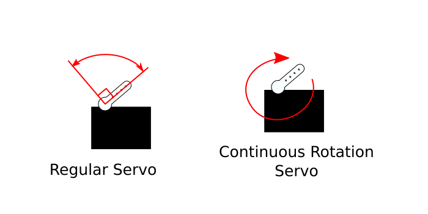

# Sweep and Intro to Servo Motors

## Intro

The official Arduino documentation is a more complete reference:

::: {.topics}

::: {.card type="external" title="Servo Motor Basics" thumb="../../../images/arduino_docs.svg" href="https://docs.arduino.cc/learn/electronics/servo-motors/" tag="Docs"}
:::

::: {.card type="external" title="For Loop" thumb="../../../images/arduino_docs.svg" href="https://docs.arduino.cc/language-reference/en/structure/control-structure/for/" tag="Docs"}
:::

:::

This lesson uses the **Servo library**. Make sure it is installed. If not, locate it in the library manager. ([Don't know how to install a library?](https://docs.arduino.cc/software/ide-v2/tutorials/ide-v2-installing-a-library/))

To open the example, go to:

**File** > **Examples** > **Servo** > **Sweep**

## The Servo Motor

Earlier we used a vibration motor, which is a simple DC motor with an unbalanced, eccentric weight attached to the shaft. A DC motor's shaft turns when it is supplied a constant DC voltage (like from a 9V battery).

A servo motor is a specialized motor designed for **precise control** of rotary motion. There are two types of servo motors that I would like to point out:

- **Positional (Standard Rotation):** Control the angle, within a range of 180 degrees.
- **Continuous Rotation:** Control the speed and direction. It can keep turning a full 360 degrees.



::: {.video-embed}
<iframe src="https://www.youtube.com/embed/XrEN1oszq_Y" title="Positional vs Continuous Rotation Servo Motors" loading="lazy" allow="accelerometer; autoplay; clipboard-write; encrypted-media; gyroscope; picture-in-picture; web-share" referrerpolicy="strict-origin-when-cross-origin" allowfullscreen></iframe>

**Positional vs Continuous Rotation Servo Motors**  
Science Buddies.
:::

Both types look exactly the same, and both are controlled using a **Pulse Width Modulation (PWM)** signal. The servo gets its power from a separate wire. The signal only tells it what to do: on a positional servo, the width of each pulse sets the angle. The Servo library sends these pulses for you, so you don't need `analogWrite()`.

Check out [Fade and Intro to PWM](../fade/fade.html) for a refresher on PWM.

## Wiring

For this lesson, please collect the following:

- Arduino Nano 33 IoT and USB cable
- Servo motor
- Jumper wires

A servo has three wires:

- **Brown or black** wire → **GND**
- **Red** wire → **Vin**
- **Orange, yellow or white** wire → pin **D9**

The servo needs about 5V, and the Nano's 3.3V pin isn't enough. **Vin** gets 5V from the USB while the board is plugged in (see [5V vs 3.3V](../blink/blink.html#v-vs-3.3v)). Only connect the red wire to Vin, never to a numbered pin. Those pins only take 3.3V.

**If the servo shakes or the Arduino restarts,** the servo may be pulling more power than the USB can give. This is more likely with a heavy load or more than one servo. Power the servo from the [breadboard power supply module](../../Workshops/Breadboard_Circuits/breadboard_circuits.html#part-2-powering-the-breadboard) set to 5V instead:

- **Red** wire → **+** rail
- **Brown or black** wire → **–** rail
- **–** rail → the Nano's **GND**, so they share a ground
- **Orange, yellow or white** wire → pin **D9**, the same as before

Don't connect the **+** rail to the Nano.

## Minimal Example

```arduino
#include <Servo.h>

Servo myservo;  // create servo object to control a servo

void setup() {
  myservo.attach(9);  // attaches the servo on pin 9 to the servo object
}

void loop() {
  myservo.write(180);  // tell the servo to go to 180 degrees
}
```

### Breakdown

```arduino
#include <Servo.h>
```

To include the library, you have to write this statement. `#include` is written followed by the name of the file that has the code of the library. This `Servo.h` file is the Servo library. It is surrounded by angle brackets. [More about `#include`](https://docs.arduino.cc/language-reference/en/structure/further-syntax/include/).

```arduino
Servo myservo;  // create servo object to control a servo
```

For this library, there is an object called Servo, and it is given the variable name `myservo`.

> The Arduino language is an **Object-Oriented Programming** language. An object is similar to a data type, except that it is a *data structure*. It is more of a defined thing with certain defined attributes. For example, an object called Human might have properties such as age, height, name, etc. and can perform actions like `human.walk()`, `human.sleep()`, `human.eat()`.
>
> In this Servo library, there is an object defined called Servo that has the properties of a servo motor, with actions like `attach()` and `write()`.

```arduino
myservo.attach(9);  // attaches the servo on pin 9 to the servo object
```

As said in the comment, this line tells Arduino that this servo is connected to pin 9.

```arduino
myservo.write(180);  // tell the servo to go to 180 degrees
```

The `write()` method changes the position of the servo and takes an angle between 0 and 180 degrees.

### Play Around

Try changing the number in `write()` to see where the servo moves.

## The Full Sweep Example

```arduino
#include <Servo.h>

Servo myservo;  // create Servo object to control a servo
// twelve Servo objects can be created on most boards

int pos = 0;    // variable to store the servo position

void setup() {
  myservo.attach(9);  // attaches the servo on pin 9 to the Servo object
}

void loop() {
  for (pos = 0; pos <= 180; pos += 1) { // goes from 0 degrees to 180 degrees
    // in steps of 1 degree
    myservo.write(pos);              // tell servo to go to position in variable 'pos'
    delay(15);                       // waits 15 ms for the servo to reach the position
  }
  for (pos = 180; pos >= 0; pos -= 1) { // goes from 180 degrees to 0 degrees
    myservo.write(pos);              // tell servo to go to position in variable 'pos'
    delay(15);                       // waits 15 ms for the servo to reach the position
  }
}
```

A variable is defined to store the angle position.

```arduino
int pos = 0;    // variable to store the servo position
```

## For Loops

The `loop()` function in this sketch is using two **for loops**. The structure of a for loop is this:

```arduino
for (initialization; condition; increment) {
    // statement(s);
}
```

There are three things that need to be specified within the parentheses `()`:

- **initialization:** You need to initialize a variable with a starting value. `i` is used often by convention. This is like a setup function, as it happens first and only happens once.
- **condition:** Each time through the loop, a condition is tested. If it is *true*, then whatever is within the curly brackets is executed.
- **increment:** After each loop, the variable defined in the initialization is incremented by a certain amount.

So in our example:

```arduino
for (pos = 0; pos <= 180; pos += 1) {
    // the code executed if true
}
```

- **`pos = 0`:** The `pos` variable starts with an *initial* value of 0.
- **`pos <= 180`:** The *condition* checks to see if `pos` is **less than or equal to** 180.
- **`pos += 1`:** If the condition is true, whatever is within the curly brackets is executed, and `pos` is *incremented* by 1.

The loop repeats until the condition is false, which is when `pos` reaches the value of 181. 181 is no longer less than or equal to 180. We then exit the for loop and continue.

The second for loop is the same, except `pos` is given an initial value of 180, the condition checks to see if `pos` is **greater than or equal to** 0, and `pos` is **decremented** (decreased by 1) each time.

## Further Material

### Video Tutorials

::: {.video-embed}
<iframe src="https://player.vimeo.com/video/372278570" title="Analog Output - Servo" loading="lazy" allow="autoplay; fullscreen; picture-in-picture; clipboard-write; encrypted-media; web-share" referrerpolicy="strict-origin-when-cross-origin" allowfullscreen></iframe>

**Analog Output - Servo**  
NYU ITP Physical Computing. A video on servo control.
:::
