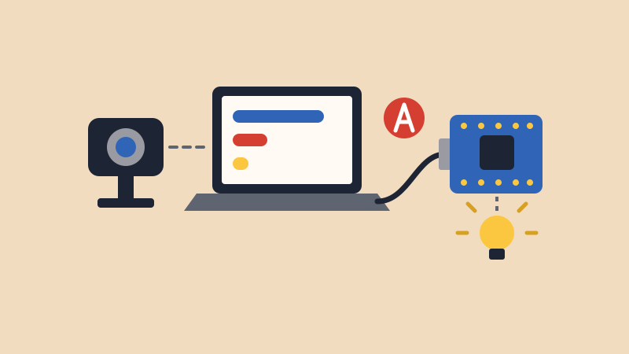

# Teachable Machine

{alt="A webcam sends a picture to a laptop running a model, and the laptop sends one letter over a USB cable to an Arduino, which lights an LED."}

## Intro

[Teachable Machine](https://teachablemachine.withgoogle.com/){target="_blank"} lets you train a computer to recognize things by showing it examples, with no code. You could show it a thumbs up and a thumbs down, your face and an empty chair, or a red cup and a blue cup.

Your laptop runs the model, and it tells your Arduino what it sees by sending one letter over the USB cable. Your Arduino just needs to know what to do with each letter.

Your board doesn't run the model itself. Even Teachable Machine's smallest model for microcontrollers is about 500 KB, and the Nano 33 IoT holds 256 KB. So your laptop and USB cable need to stay connected the whole time.

## Materials

- Arduino Nano 33 IoT and USB cable
- A laptop with a webcam, connected to the internet
- **Chrome** or **Edge**. Other browsers may not be able to talk to the Arduino.

## 1. Train Your Model

1. Go to [Teachable Machine's image project](https://teachablemachine.withgoogle.com/train/image){target="_blank"} and choose **Standard image model** if it asks.
2. Rename **Class 1** and **Class 2** to the things you want to recognize. Click **Add a class** for more. Your classes get the letters **A**, **B**, **C** and so on, from top to bottom.
3. For each class, click **Webcam** and use **Hold to Record**. Move around as you record, so it sees different angles and distances.
4. Click **Train Model**, and leave the tab open until it's done.
5. Test it in the **Preview** panel. If it gets confused, add more examples and train again.

**Add a class for "nothing."** Record the empty background, with nothing you care about in view. Otherwise, the model has to choose one of your classes even when nothing is there.

**Train it where you'll show it.** A model learns the lighting and background along with your object, so record in the room where you'll use it.

## 2. Get Your Model's Link

1. Click **Export Model**.
2. Under **Upload (shareable link)**, click **Upload my model**.
3. Wait for it to finish, then copy the link under **Your sharable link:**.

<blockquote class="info">
<span class="uk-label">Note</span>
<p>Teachable Machine says your training samples aren't sent to any servers. Only the finished model is uploaded, and anyone with the link can use it.</p>
</blockquote>

## 3. Upload the Arduino Sketch

Each time the model becomes sure of something new, your Arduino gets one letter. This sketch turns the built-in LED on for **A** and off for **B**.

```arduino
// Teachable Machine: do something with each letter

void setup() {
  Serial.begin(9600);
  pinMode(LED_BUILTIN, OUTPUT);
}

void loop() {
  if (Serial.available() > 0) {
    char letter = Serial.read();

    if (letter == 'A') {
      digitalWrite(LED_BUILTIN, HIGH);
    }
    if (letter == 'B') {
      digitalWrite(LED_BUILTIN, LOW);
    }
  }
}
```

This is the same `Serial.read()` from the [Keyboard](../Keyboard/Keyboard.html) lesson. There, you typed letters into the Serial Monitor. Here, the bridge page types them for you.

After uploading, **close the Serial Monitor**. Only one program can use the board at a time.

## 4. Open the Bridge

**[Open the Teachable Machine Bridge](bridge.html){target="_blank"}** in Chrome or Edge.

1. Paste your link and click **Load**. Your classes show up with their letters.
2. Click **Start Camera** and allow the camera.
3. Click **Connect Arduino**, choose your board in the list and click **Connect**.

Now show the camera your classes. The bars show how sure the model is, and your Arduino's LED changes when the letter changes.

The slider sets how sure the model has to be before it sends a letter. Raise it if the letter changes when it shouldn't. Lower it if the letter never changes.

## 5. Make It Do Something

Once the LED works, change what each letter does. For example, here's a [servo](../sweep/sweep.html) that moves to a different angle for each class. Wire it as in the Sweep lesson, with the signal wire on pin 9.

```arduino
// Teachable Machine: move a servo with each letter

#include <Servo.h>

Servo myservo;

void setup() {
  Serial.begin(9600);
  myservo.attach(9);
}

void loop() {
  if (Serial.available() > 0) {
    char letter = Serial.read();

    if (letter == 'A') {
      myservo.write(0);
    }
    if (letter == 'B') {
      myservo.write(90);
    }
    if (letter == 'C') {
      myservo.write(180);
    }
  }
}
```

More ideas:

- **Make a sound:** Connect a passive buzzer to pin 8. Use `tone(8, 440);` for one letter and `noTone(8);` for another.
- **Light it up:** Choose a color on your [RGB LED](../rgb_led/rgb_led.html) for each class.
- **Press a key:** Use `Keyboard.write()` from the [Keyboard and Mouse](../Keyboard/Keyboard.html) lesson, so your model can play a game.

Want to change how the page looks or what it does? The [p5.js Bridge](../p5_bridge/p5_bridge.html) tutorial shows how to build your own.

## When Something Goes Wrong

- **"Couldn't load that model."** Check that you copied the whole link and clicked **Upload my model**. If you changed your classes, click **Update my cloud model** in Teachable Machine.
- **"Couldn't open the board."** Close the Serial Monitor, and close any other page that's connected to your Arduino.
- **Your board isn't in the list.** Check the USB cable, since some only charge, and use Chrome or Edge.
- **The bars move, but the LED doesn't.** Look at **Sent to Arduino** on the page. If it changes, check that your sketch uses the same letters. If it doesn't, your model isn't sure enough, so lower the slider.
- **It works in Teachable Machine but not here.** Check that your classes are in the order you expect, since the top class is **A**. Make sure you loaded the newest version of your model too.
- **It only sort of works.** Add more examples with different angles, distances and lighting. Check your "nothing" class too.
- **You want to see what your sketch is doing.** The Serial Monitor has to stay closed, so use `Serial.println()`, and it shows up under **From your Arduino** on the bridge page.
