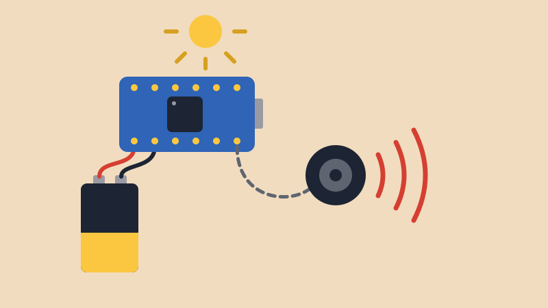
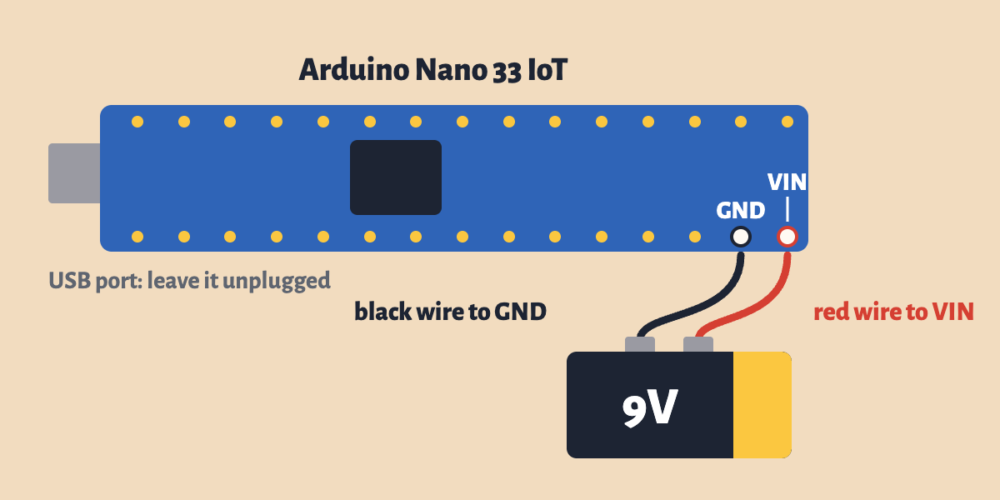

# VIN: Running Without a Laptop

{alt="A 9V battery wired to an Arduino Nano's VIN pin, with no USB cable. Light falls on the board and a buzzer plays sound."}

## Intro

So far, your laptop has powered your Arduino through the USB cable. But your sketch is stored on the board itself, so you only need the laptop to upload it. Give the board power another way, and it starts your sketch by itself.

The **VIN** pin is one way in. We'll take the [Light Theremin](../buzzer_speaker/buzzer_speaker.html) you built in Week 8 and run it without a laptop, so you can carry it around the room. There's no new code and no new circuit.

What could your final project do if it didn't have to stay next to a laptop?

## Materials

- Arduino Nano 33 IoT, USB cable and breadboard
- From your kit: passive buzzer, photoresistor, 10kΩ resistor and jumper wires
- A power source, either:
  - a **9V battery** and a **9V battery clip** (the snap connector with a red and a black wire), or
  - your kit's **power supply module** and **9V adapter**

## 1. Build the Light Theremin

This is the same circuit as the [Buzzer lesson](../buzzer_speaker/buzzer_speaker.html):

- Buzzer **+** leg → pin **D8**
- Buzzer **−** leg → **GND**
- **3.3V** → one leg of the photoresistor
- Other leg of the photoresistor → **A0**, and also → **10kΩ resistor** → **GND**

## 2. Upload the Sketch

With the USB cable plugged in, upload the version that calibrates itself. For the first 5 seconds after it gets power, it measures the light while the built-in LED is on. That means it adjusts to wherever you are when you turn it on.

```arduino
int buzzerPin = 8;
int sensorPin = A0;

int lowest = 1023;   // start high, so any reading will be lower
int highest = 0;     // start low, so any reading will be higher

void setup() {
  pinMode(buzzerPin, OUTPUT);
  pinMode(LED_BUILTIN, OUTPUT);

  // calibrate for 5 seconds while the LED is on
  digitalWrite(LED_BUILTIN, HIGH);
  while (millis() < 5000) {
    int lightValue = analogRead(sensorPin);
    if (lightValue < lowest) {
      lowest = lightValue;
    }
    if (lightValue > highest) {
      highest = lightValue;
    }
  }
  digitalWrite(LED_BUILTIN, LOW);
}

void loop() {
  int lightValue = analogRead(sensorPin);
  int pitch = map(lightValue, lowest, highest, 200, 2000);
  pitch = constrain(pitch, 200, 2000);
  tone(buzzerPin, pitch);
  delay(10);
}
```

Make sure it works on USB before you go on: wave your hand over the sensor while the LED is on, then play it.

## 3. Power It Through VIN

Unplug the USB cable first, then choose one of these.

### With a 9V Battery



With the battery **not yet snapped on**:

- Clip's **red** wire → the **VIN** pin's row, the corner pin farthest from the USB port
- Clip's **black** wire → the **GND** pin's row, right next to VIN

Check both wires, then snap on the battery. The clip's wires are thin, so tape them down if they slip out of the breadboard.

<blockquote class="warning">
<span class="uk-label" style="color:black; background:#fac100">Warning</span>
<p><strong>9V only goes to VIN.</strong> Every other pin takes 3.3V at most, so 9V on any other pin can destroy the board. Swapping red and black can too. Keep the red wire off the + rail, because your + rail may be connected to the 3.3V pin. If a servo's red wire is on VIN from the <a href="../sweep/sweep.html">Sweep</a> lesson, take it off first: VIN now has 9V instead of the USB's 5V.</p>
</blockquote>

A 9V battery is small, so unsnap it when you're done. Always unsnap it before you plug the USB cable back in.

### With Your Power Supply Module

This frees you from the laptop, but you're still near a wall outlet.

1. **Set up the module** as in the [Breadboard Circuits](../../Workshops/Breadboard_Circuits/breadboard_circuits.html) workshop, with both jumpers on **5V** and the power off.
2. **Take off any wire between the Nano's 3.3V pin and the + rail.** The + rail now has 5V on it, and 5V on the 3.3V pin can destroy the board. Connect the photoresistor straight to the 3.3V pin's row instead.
3. **+ rail → VIN**, and **– rail → GND**.
4. Plug in the adapter and press the module's power button.

## 4. Play It

The built-in LED comes on for 5 seconds as soon as the board gets power. Wave your hand over the sensor while it's on, so the sketch sees the brightest and darkest light you'll use. When the LED goes off, play it.

Now carry it around. What does it sound like near a window, under a table or in someone's shadow? Each new place has different light, so disconnect the power and reconnect it to calibrate again.

## How VIN Works

In the [Sweep](../sweep/sweep.html) lesson, we used VIN to get 5V from the USB out to a servo. It also works as a way in. The board has a **regulator** that turns the voltage on VIN into the 3.3V the board runs on, and that's why VIN can take 9V when the other pins can't.

Your 3.3V pin still gives 3.3V, so the rest of your circuit doesn't change.

## Try It

- **Any sketch:** This works for everything you've made. Try your [Knock](../knock/knock.html) sketch or your midterm.
- **Hide it:** Put the board and battery inside a box, a ball or a hat. How does that change what people think it is?
- **Tilt instead of light:** Swap the photoresistor for the board's built-in [accelerometer](https://docs.arduino.cc/tutorials/nano-33-iot/imu-accelerometer){target="_blank"}, so tilting the board changes the pitch. This is where having no cable really helps.

## When Something Goes Wrong

- **Nothing happens.** Check that the board's power light is on. If it isn't, check the wires on VIN and GND, then try a fresh battery. If you're using the module, make sure its jumpers are on 5V and its power is on.
- **It works on USB but not on VIN.** Look for `while (!Serial);` in your sketch and remove it. That line waits for a laptop to connect, so with no laptop it waits forever.
- **It only plays one pitch, or barely changes.** The sketch didn't see enough change in the light during those 5 seconds. Disconnect the power, reconnect it, and wave your hand over the sensor while the LED is on.
- **It's quiet.** Try playing it in a quieter spot, or see the note about volume in the [Buzzer lesson](../buzzer_speaker/buzzer_speaker.html).
