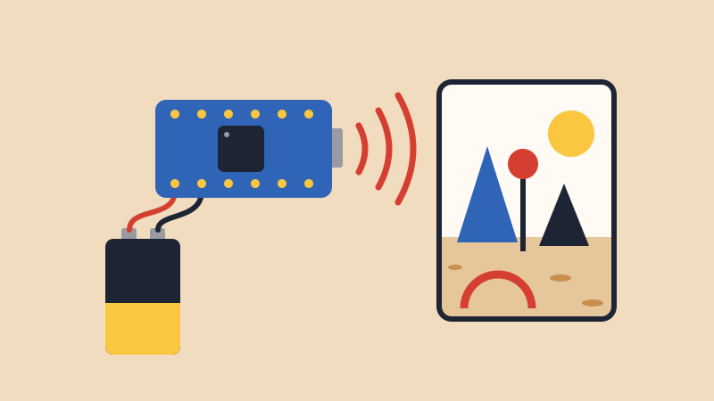
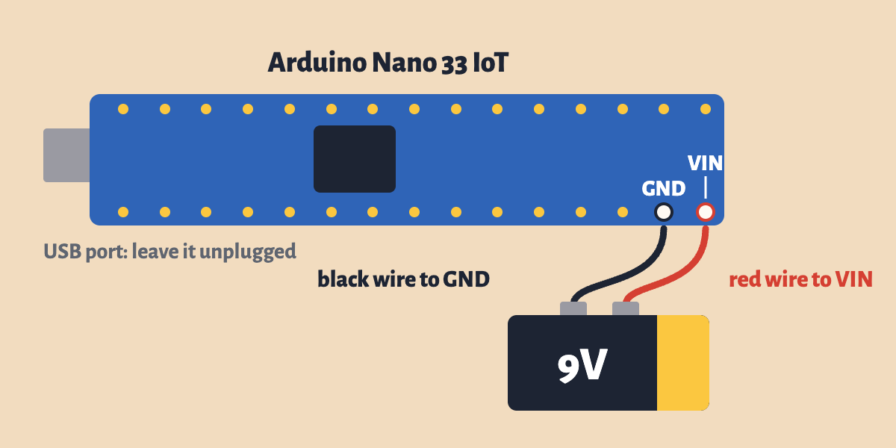

# Cut the Cord

{alt="A 9V battery wired to an Arduino Nano, which sends Wi-Fi waves to a VR world of cones, poles and a sun."}

## Intro

So far, your Arduino has been tied to your laptop by a USB cable. Let's cut that cord. A **9V battery** powers the board, and its built-in **accelerometer** sends how it's tilted over **Wi-Fi** to a laptop. Tilt the board and you move through a VR world.

**[Try the world with your mouse](../../Workshops/Velostat_Workshop/station/tilt_world.html){target="_blank"}.** It runs in your browser, with no Arduino needed.

Your final project doesn't have to sit next to a laptop. What could you build if your Arduino could go anywhere: inside a ball, on your body or across the room?

## Materials

- Arduino Nano 33 IoT, USB cable and breadboard
- **9V battery** and a **9V battery clip** (the snap connector with a red and a black wire)
- Tape, to hold the battery and breadboard together
- A laptop on the same Wi-Fi network as your board, running the world. In class, I'll run it on mine.

## 1. Upload the Sketch

You still need the USB cable for this step. You already installed the **WiFiNINA** library for the Class Sensor Grid. Also install **Arduino_LSM6DS3** from the **Library Manager**.

1. Make a new sketch (**File** > **New Sketch**), delete everything in it, and paste in the whole sketch below.
2. Change `ROUTER_NAME` and `ROUTER_PASSWORD` to the Wi-Fi name and password on the board. Keep the quotes.
3. Choose **Tools** > **Board** > **Arduino SAMD Boards** > **Arduino Nano 33 IoT**, and your board's **Port**.
4. Click **Upload**.
5. Open the **Serial Monitor** (115200 baud). It prints your **board ID**, and then `Joined` when it's on the Wi-Fi.

<a href="../../Workshops/Velostat_Workshop/station/tilt_world/tilt_world.ino" download>Download tilt_world.ino</a>

```arduino
/*
  Tilt World (ART 150, Cut the Cord lesson)

  Reads the Nano 33 IoT's built-in accelerometer and sends it over Wi-Fi to
  the laptop running relay.py --tilt, where tilting the board moves you
  through a VR world.

  Upload this once over USB. Then unplug the USB cable and power the board
  from a 9V battery: red wire to VIN, black wire to GND. The sketch stays in
  the board's memory and starts by itself whenever it gets power.

  With no computer attached, the built-in LED tells you what's happening:
    - flashing: joining the Wi-Fi
    - on:       connected and sending
    - fast:     the accelerometer didn't start

  The only lines to change are the Wi-Fi name and password just below.

  How it works: about 30 times a second, the board sends a line like
  "V3F9A21,-120,30,980" over UDP. That's this board's ID (the last six
  characters of its hardware address), then x, y and z in thousandths of a g.
  The laptop's relay.py announces itself on the network once a second. The
  board sends straight to it once it hears that, and to the whole network
  until then.
*/

#include <SPI.h>
#include <WiFiNINA.h>
#include <WiFiUdp.h>
#include <Arduino_LSM6DS3.h>

// ---- change these two lines to the classroom router's 2.4 GHz network ----
const char WIFI_NAME[] = "ROUTER_NAME";
const char WIFI_PASSWORD[] = "ROUTER_PASSWORD";

const unsigned int UDP_PORT = 9000;     // relay.py listens here
const unsigned int BEACON_PORT = 9001;  // relay.py announces itself here
const unsigned long SEND_EVERY = 33;    // ms: about 30 messages a second

WiFiUDP udp;
char boardId[7];                // e.g. "3F9A21"
IPAddress sendTo;               // the whole network, until we hear the relay
bool wifiReady = false;
unsigned long lastWifiTry = 0;
unsigned long lastSend = 0;

void setup() {
  // Serial is fine on a battery, but never add "while (!Serial);" here:
  // with no computer attached, the sketch would wait forever.
  Serial.begin(115200);
  pinMode(LED_BUILTIN, OUTPUT);

  if (!IMU.begin()) {
    Serial.println("The accelerometer didn't start");
    while (true) {
      digitalWrite(LED_BUILTIN, millis() / 80 % 2);
    }
  }

  // the MAC address comes back last byte first: mac[0] is the end of it
  byte mac[6];
  WiFi.macAddress(mac);
  snprintf(boardId, sizeof(boardId), "%02X%02X%02X", mac[2], mac[1], mac[0]);
  Serial.print("Board ID: ");
  Serial.println(boardId);

  joinWifi();
}

// Even when WiFi.begin() reports a failure, the Wi-Fi chip keeps trying on
// its own, and on a weak signal that can take 20+ seconds. Calling begin()
// again restarts that attempt, so we leave it 30 seconds between tries.
void joinWifi() {
  lastWifiTry = millis();
  Serial.print("Joining ");
  Serial.println(WIFI_NAME);
  WiFi.begin(WIFI_NAME, WIFI_PASSWORD);
}

// Once on the network, work out where to send and open the socket.
void startSending() {
  // send to the whole network (e.g. 192.168.1.255) until the relay is found
  IPAddress ip = WiFi.localIP();
  IPAddress mask = WiFi.subnetMask();
  for (int i = 0; i < 4; i++) {
    sendTo[i] = ip[i] | (~mask[i] & 0xFF);
  }
  WiFi.noLowPowerMode();   // keep the radio awake: steadier, faster sends
  udp.begin(BEACON_PORT);  // listen for the relay; we send to UDP_PORT
  wifiReady = true;
  Serial.print("Joined, address ");
  Serial.println(ip);
}

void loop() {
  if (WiFi.status() != WL_CONNECTED) {
    wifiReady = false;
    digitalWrite(LED_BUILTIN, millis() / 250 % 2);  // flash while joining
    if (millis() - lastWifiTry > 30000) {
      joinWifi();
    }
    return;
  }

  digitalWrite(LED_BUILTIN, HIGH);
  if (!wifiReady) {
    startSending();
  }

  // the relay sends "RELAY" once a second: from then on, send straight to it
  while (udp.parsePacket() > 0) {
    char buf[8] = { 0 };
    udp.read(buf, sizeof(buf) - 1);
    if (strncmp(buf, "RELAY", 5) == 0) {
      sendTo = udp.remoteIP();
    }
  }

  if (millis() - lastSend >= SEND_EVERY && IMU.accelerationAvailable()) {
    float x, y, z;
    IMU.readAcceleration(x, y, z);

    // whole numbers, because snprintf can't print decimals on this board
    char line[32];
    int len = snprintf(line, sizeof(line), "V%s,%d,%d,%d", boardId,
                       (int)(x * 1000), (int)(y * 1000), (int)(z * 1000));

    udp.beginPacket(sendTo, UDP_PORT);
    udp.write((const uint8_t *)line, len);
    udp.endPacket();
    lastSend = millis();
  }
}
```

## 2. Power It with the 9V Battery

The sketch stays in the board's memory, so from now on it starts by itself whenever the board gets power. It doesn't need your laptop anymore.



With the **USB cable unplugged** and the battery **not yet snapped on**:

- Clip's **red** wire → **VIN**, the corner pin farthest from the USB port
- Clip's **black** wire → **GND**, the pin right next to VIN

Then check both wires, and snap on the battery. Tape the battery to the breadboard, so the whole thing is one object you can hold.

<blockquote class="warning">
<span class="uk-label" style="color:black; background:#fac100">Warning</span>
<p><strong>9V only goes to VIN.</strong> Every other pin takes 3.3V at most, so 9V on 3.3V, VUSB or any other pin can destroy the board. Swapping red and black can too, so check them before you snap on the battery. If a servo's red wire is on Vin from the <a href="../sweep/sweep.html">Sweep</a> lesson, take it off first: Vin is now 9V instead of the USB's 5V.</p>
</blockquote>

Why VIN? The board has a regulator that turns the voltage on VIN into the 3.3V it runs on, and 9V is well inside the range it accepts.

The built-in LED now tells you what's happening, since there's no Serial Monitor:

- **Flashing:** joining the Wi-Fi
- **On:** connected and sending
- **Flashing very fast:** the accelerometer didn't start

**Taking care of the battery.** A 9V battery is small and Wi-Fi uses a lot of power, so expect it to last hours, not days. Unsnap it when you're not using it, and always unsnap it before you plug the USB cable back in to upload.

## 3. Start the World

In class, the world runs on my laptop and one board drives it at a time.

To run it on your own laptop, join the same Wi-Fi network and download these three files into one folder: [relay.py](../../Workshops/Velostat_Workshop/station/relay.py){download=""}, [tilt_world.html](../../Workshops/Velostat_Workshop/station/tilt_world.html){download=""} and [aframe-v1.8.0.min.js](../../Workshops/Velostat_Workshop/station/aframe-v1.8.0.min.js){download=""}. In that folder, run this in the Terminal, and the page opens in your browser:

```
python3 relay.py --tilt
```

Hold the board flat with the USB port pointing away from you. The corner of the page shows your board ID and how many messages a second are arriving.

- **Tip it left or right** to turn.
- **Tip the USB end down** to go forward, and up to go back.
- **Hold it level** to stop.

The small board on screen tilts along with the real one. These keys help:

- **C:** whatever angle you're holding it at now counts as level
- **T / F:** flip turning or forward, if it goes the wrong way
- **N:** switch to the next board, if there's more than one
- **H:** hide the words

The icon in the bottom corner makes it full screen. The world is built with [A-Frame](https://aframe.io/){target="_blank"}, a tool for making VR on the web, and it runs here on a screen. A headset can only enter VR from a secure (https) page, which this local page isn't.

## How It Works

- **The battery:** VIN takes the place of the USB cable as the board's power.
- **The tilt:** An accelerometer feels gravity. When the board is flat, gravity all lands on z. As you tip it, some of that moves to x and y, and the math turns that into an angle. Gravity can't tell you which way you're facing, though, so we steer instead: tilting sets how fast you turn and move.
- **The Wi-Fi:** About 30 times a second, the board sends a short message like `V3F9A21,-120,30,980`: its ID, then x, y and z in thousandths of a g. `relay.py` on the laptop receives these and passes them to the page.

## Try It

- **Hide it:** Tape the board and battery inside something: a ball, a hat, a puppet, a box. How does holding that object change how the world feels?
- **Pass it around:** Hand it to someone else. How long does it take them to work out the controls?
- **Without the world:** Battery power works for any sketch. Take your midterm or your [Knock](../knock/knock.html) sketch off the USB cable and see where it can go now.

## When Something Goes Wrong

- **The LED never comes on.** Check that the wires are on VIN and GND. Battery clip wires are thin and can slip out of the breadboard, so tape them down. Then try a fresh battery.
- **The LED keeps flashing.** The board can't join the Wi-Fi. Check the name and password, and that the network is 2.4 GHz. Plug in the USB cable (battery off) and read the Serial Monitor.
- **The LED is on, but the page says it's waiting for a board.** Make sure the laptop is on the same network as the board and `relay.py` is running. If your Mac asks whether Python can accept incoming connections, click **Allow**.
- **You keep moving when you hold it level.** Hold it the way you want and press **C**.
- **It turns or moves the wrong way.** Press **T** or **F**.
- **It stutters.** Move closer to the router.
- **The page says the board went quiet.** The battery may be running out, or the wires may have slipped. Check that the LED is still on.
