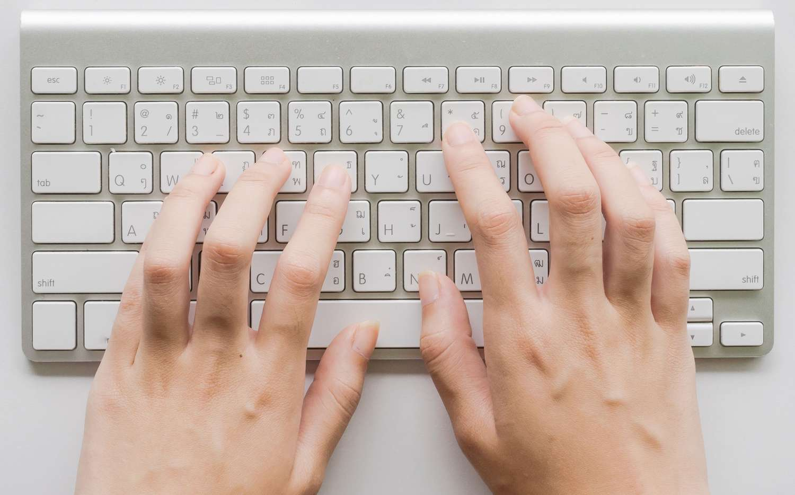
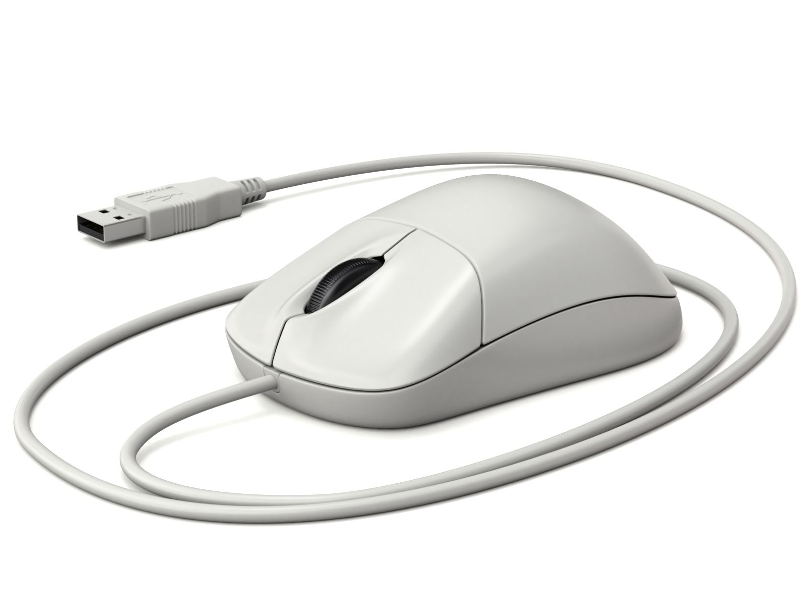
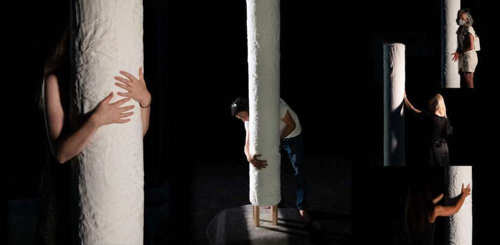
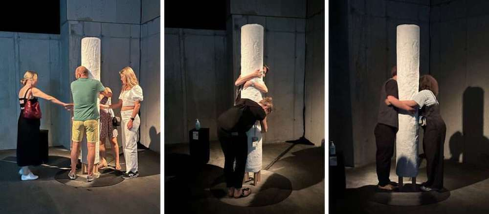
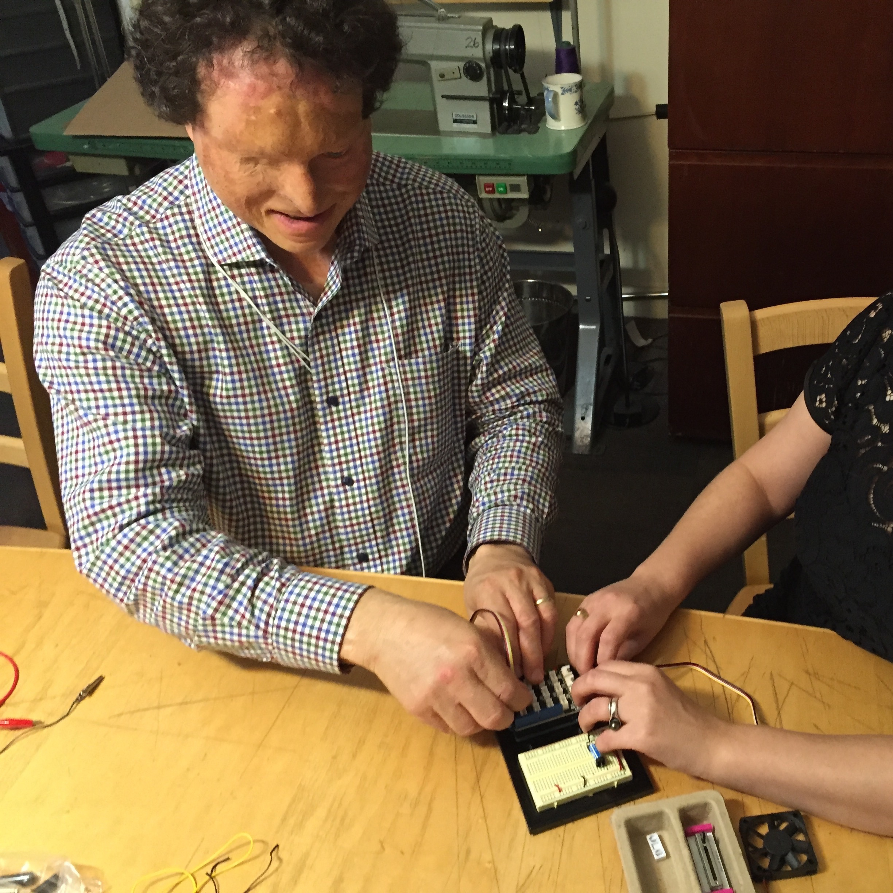
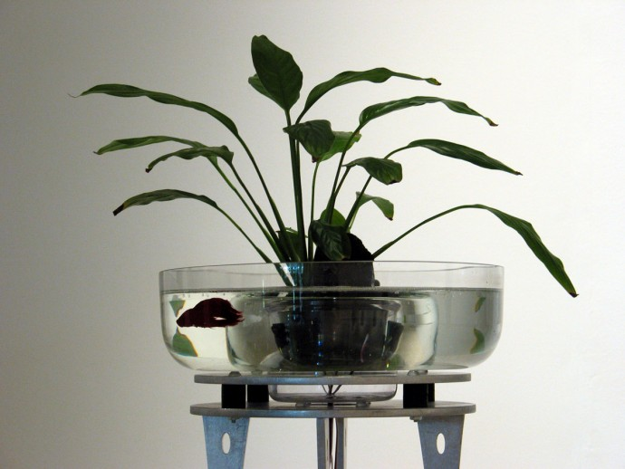
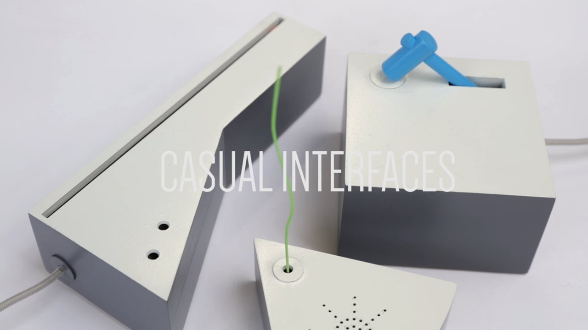
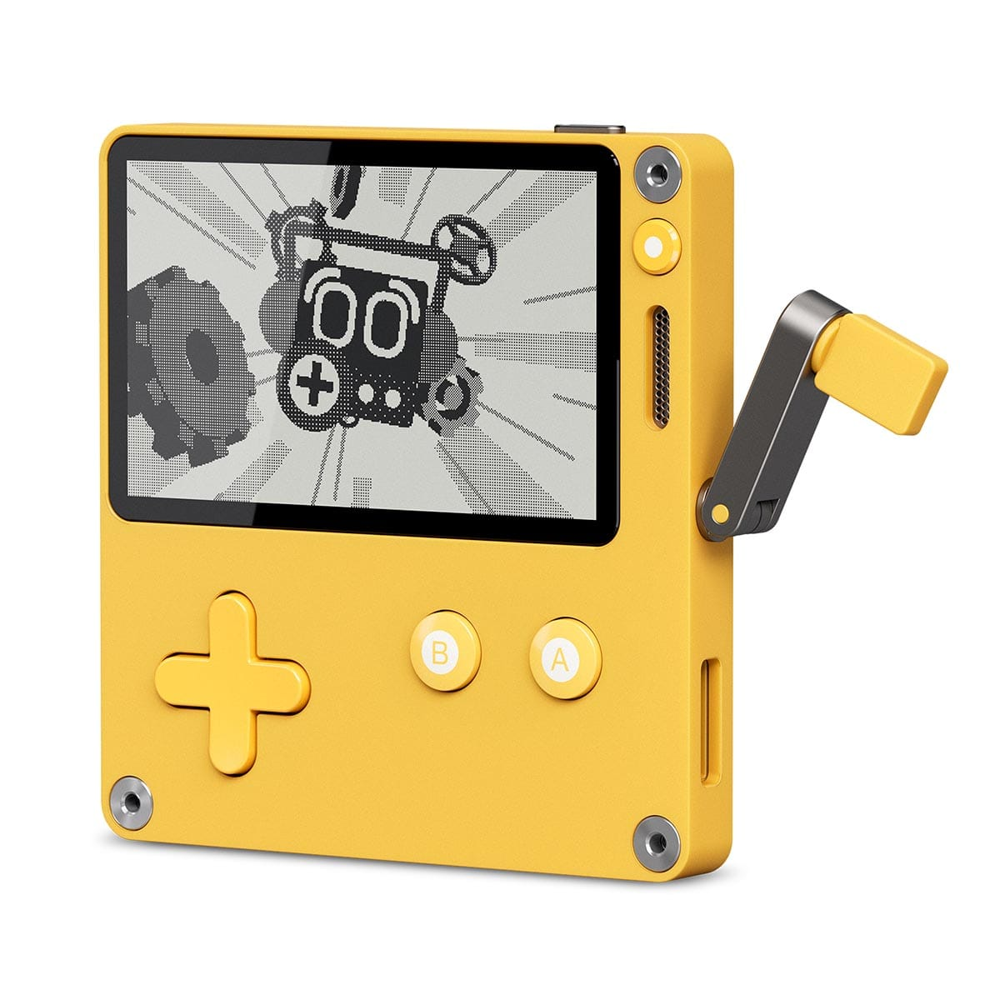
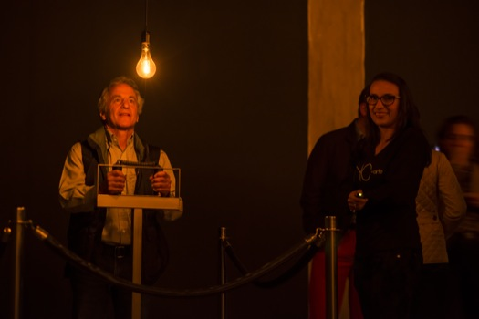
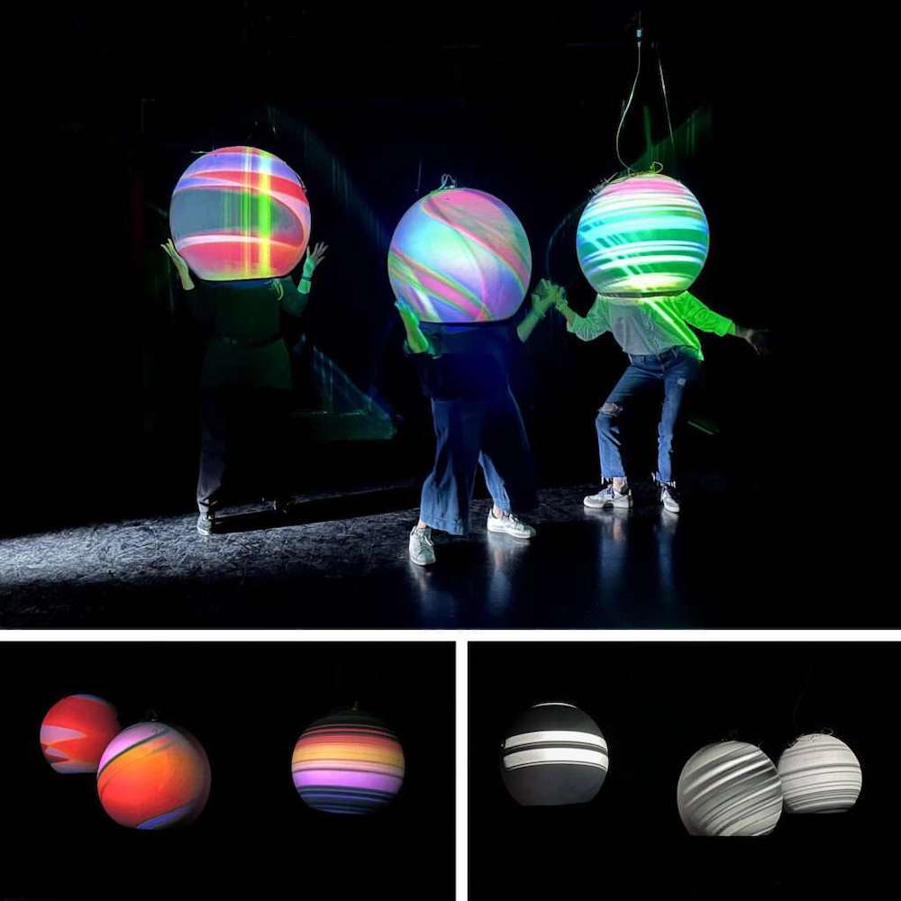

## Midterm: Creative Interfaces
<!-- .slide: class=".uk-width-1-1 uk-height-large" -->

<p class="lead">Critique: Wednesday, October 28</p>

Note:
Four parts: what an interface is, the reading, a lot of examples, then the assignment itself.

---

### Part 1
## What is an interface?

---

#### Formal Definition

<p class="lead">When it comes to hardware, interfaces are the physical and interactable means that bridge the communication between humans and computers.</p>

<p class="lead">They are usually designed to <strong>"enhance"</strong> the user experience: to make our tasks easier.</p>

---

#### We use them every day

<div class="cols">
<div>
</img>
<p class="caption">Keyboard</p>
</div>
<div>
</img>
<p class="caption">Mouse</p>
</div>
</div>

---

#### The first mouse (1968)

<iframe width="800" height="450" src="https://www.youtube.com/embed/yJDv-zdhzMY" title="The Mother of All Demos" frameborder="0" allow="accelerometer; autoplay; clipboard-write; encrypted-media; gyroscope; picture-in-picture; web-share" allowfullscreen></iframe>

<p class="caption">Douglas Engelbart, <em>The Mother of All Demos</em>, 1968</p>

Note:
The first public demo of the mouse, hypertext, video calls and shared editing. Someone had to invent the mouse: none of these interfaces are "natural."

---

#### Informal Definition

<p class="lead">Interfaces are the touchpoints: the computer's <strong>"sensors"</strong> that let it perceive the world around it.</p>

---

#### What we can build with

<div class="cols">
<div>
<p class="lead"><strong>Switch (button)</strong></p>
<p class="lead">Makes or breaks a connection.<br>Open vs. closed circuit.</p>
<p class="caption"><code>digitalRead()</code>: 2 states</p>
</div>
<div>
<p class="lead"><strong>Variable resistor</strong></p>
<p class="lead">Potentiometer, photoresistor, Velostat, graphite.</p>
<p class="caption"><code>analogRead()</code>: 1024 states</p>
</div>
</div>

---

### Part 2
## The Interface as Artwork

<p class="caption">Marie-Eve Morissette, Louis-Philippe Rondeau and Yan Breuleux, <em>Live Interfaces</em>, 2024</p>

---

#### Control vs. Encounter

> "Interaction is about encounter rather than control."
>
> — David Rokeby

Note:
Control: precise, predictable, the user commands and the machine obeys (a keyboard).
Encounter: open-ended, exploratory, the result emerges from the meeting between you and the work. The reading argues the interface can be the artwork itself, a "zone of experience," not just a tool you control something with.

---

#### Control vs. Encounter

<div class="cols">
<div>
<p class="lead"><strong>Control</strong></p>
<p class="lead">Precise, predictable.<br>You give a command, the machine obeys.</p>
</div>
<div>
<p class="lead"><strong>Encounter</strong></p>
<p class="lead">Exploratory, surprising.<br>The result comes from the meeting between you and the work.</p>
</div>
</div>

---

#### David Rokeby: Very Nervous System (1986–1990)

<iframe src="https://player.vimeo.com/video/8120954" width="800" height="450" frameborder="0" allow="autoplay; fullscreen; picture-in-picture" allowfullscreen></iframe>

<p class="caption">A camera reads your movement and turns it into sound. The interface is almost invisible: the whole space is the interface.</p>

---

#### Golan Levin & Zachary Lieberman: Re:MARK (2002)

<iframe src="https://player.vimeo.com/video/2374790" width="800" height="450" frameborder="0" allow="autoplay; fullscreen; picture-in-picture" allowfullscreen></iframe>

<p class="caption">Your voice becomes letters and shapes that rise out of your shadow.</p>

---

#### Morissette, Rondeau & Breuleux: ON/CONTACT (2022)

</img>

<p class="caption">A soft column you hug. A homemade tactile sensor triggers sounds and vibrations, and your touch leaves marks on its surface.</p>

Note:
The sensor inside is analog, a pressure sensor, like the Velostat sensor we built. The column was deliberately not designed as a musical instrument.

---

#### ON/CONTACT

</img>

<p class="caption">People started hugging it in groups: an encounter with yourself, with others, and with the artwork.</p>

---

#### ON/CONTACT

<iframe width="800" height="450" src="https://www.youtube.com/embed/jLkTYatKP3g" title="ON/CONTACT" frameborder="0" allow="accelerometer; autoplay; clipboard-write; encrypted-media; gyroscope; picture-in-picture; web-share" allowfullscreen></iframe>

---

#### Scenocosme: Lights Contacts

<iframe width="800" height="450" src="https://www.youtube.com/embed/zOt3jzVaRjo" title="Lights Contacts" frameborder="0" allow="accelerometer; autoplay; clipboard-write; encrypted-media; gyroscope; picture-in-picture; web-share" allowfullscreen></iframe>

<p class="caption">It only works when people touch each other: the bodies are the interface.</p>

---

#### Discussion

- Is the interface a tool, or is it the artwork?
- What does your body do in each of these pieces?
- Where is the line between controlling something and encountering it?

---

### Part 3
## What if…?

<p class="lead">This is an art course. We can stretch, challenge, discard, or reinvent what an interface can be.</p>

<p class="lead">What if we challenged the word <strong>"enhance"</strong>?</p>

---

#### What if it was for someone who couldn't use their hands?

<iframe src="https://player.vimeo.com/video/70932989" width="800" height="450" frameborder="0" allow="autoplay; fullscreen; picture-in-picture" allowfullscreen></iframe>

<p class="caption"><em>The EyeWriter</em> (2009): a low-cost eye tracker built from PlayStation camera parts so graffiti artist Tempt1, paralyzed by ALS, could draw again.</p>

---

#### What if it was for someone who couldn't use a regular controller?

<iframe width="800" height="450" src="https://www.youtube.com/embed/9fcK19CAjWM" title="Introducing the Xbox Adaptive Controller" frameborder="0" allow="accelerometer; autoplay; clipboard-write; encrypted-media; gyroscope; picture-in-picture; web-share" allowfullscreen></iframe>

<p class="caption">Xbox Adaptive Controller: big buttons, and ports to plug in any switch.</p>

---

#### What if you made the switch yourself?

</img>

<p class="caption"><a href="https://www.diyability.org/">DIYAbility</a>: homemade switches for people with disabilities.</p>

---

#### What if it wasn't for humans? For plants?

<iframe width="800" height="450" src="https://www.youtube.com/embed/1hae2Fwrqn8" title="Akousmaflore" frameborder="0" allow="accelerometer; autoplay; clipboard-write; encrypted-media; gyroscope; picture-in-picture; web-share" allowfullscreen></iframe>

<p class="caption">Scenocosme, <em>Akousmaflore</em> (2007): plants that sing when you touch them.</p>

---

#### For animals?

</img>

<p class="caption">Ken Rinaldo, <em>Augmented Fish Reality</em> (2004): Siamese fighting fish drive their own robotic bowls by swimming toward an edge.</p>

---

#### For wind, light, or an imaginary being?

<a href="https://vimeo.com/150344536" target="_blank"></img></a>

<p class="caption">Martin Skelly, <em>Casual Interfaces</em>. <a href="https://vimeo.com/150344536" target="_blank">Watch on Vimeo</a></p>

---

#### What if it wasn't useful at all?

<iframe width="800" height="450" src="https://www.youtube.com/embed/aqAUmgE3WyM" title="Useless Box" frameborder="0" allow="accelerometer; autoplay; clipboard-write; encrypted-media; gyroscope; picture-in-picture; web-share" allowfullscreen></iframe>

<p class="caption">The Useless Box: its only job is to turn itself off.</p>

Note:
Just for fun? For play? For aesthetics? For a pointless task? For a ritual? For a protest?

---

#### What if it used everyday materials? A banana?

<iframe width="800" height="450" src="https://www.youtube.com/embed/rfQqh7iCcOU" title="MaKey MaKey" frameborder="0" allow="accelerometer; autoplay; clipboard-write; encrypted-media; gyroscope; picture-in-picture; web-share" allowfullscreen></iframe>

<p class="caption">Makey Makey: anything slightly conductive (fruit, play-doh, water, people) becomes a key.</p>

---

#### What if it was on your body?

<iframe width="800" height="450" src="https://www.youtube.com/embed/YxdlYFCp5Ic" title="electric stimulus to face" frameborder="0" allow="accelerometer; autoplay; clipboard-write; encrypted-media; gyroscope; picture-in-picture; web-share" allowfullscreen></iframe>

<p class="caption">Daito Manabe, <em>Electric Stimulus to Face</em> (2008)</p>

---

#### What if a familiar interface did something unexpected?

</img>

<p class="caption">Playdate: a game console with a crank.</p>

---

#### What if it needed many people? A whole room?

<div class="cols">
<div>
</img>
<p class="caption">Rafael Lozano-Hemmer, <em>Pulse Room</em> (2006): your heartbeat flashes a light bulb, and joins hundreds of heartbeats from earlier visitors.</p>
</div>
<div>
</img>
<p class="caption">Morissette, Rondeau & Breuleux, <em>EN/GLOBE</em> (2023): the whole room is the interface.</p>
</div>
</div>

---

#### More questions to ask

- Wearable? Portable? Anchored to one place?
- Extremely heavy? Extremely light?
- An interface with a bird's feather?
- An interface with a fork?
- Large scale? Tiny?
- Recycled or organic materials?
- More than one person? A community?
- Extremely simple? Extremely complex?

---

#### Past ART 150 students

<p class="lead">Creative switches from Sabrina Raaf's section of ART 150:</p>

<p class="lead"><a href="https://art150.nma-course.online/category/all-posts/creative-switch/" target="_blank">art150.nma-course.online →</a></p>

---

### Part 4
## The Assignment

---

#### The Assignment

<p class="lead">Design a <strong>physical interface</strong> that could be imagined to be connected to a computer.</p>

<p class="lead">Cardboard, paper, foil and tape are fine. Think of it as a prototype for a more refined version. Don't let the materials limit your ideas.</p>

---

#### Arduino: pick one

<div class="cols">
<div>
<p class="lead"><strong>Digital</strong> (on/off)</p>
<pre><code class="language-arduino" data-trim>
void setup() {
  pinMode(2, INPUT);
  Serial.begin(9600);
}
void loop() {
  int sensorValue = digitalRead(2);
  Serial.println(sensorValue);
}
</code></pre>
</div>
<div>
<p class="lead"><strong>Analog</strong> (0–1023)</p>
<pre><code class="language-arduino" data-trim>
void setup() {
  Serial.begin(9600);
}
void loop() {
  int sensorValue = analogRead(A0);
  Serial.println(sensorValue);
}
</code></pre>
</div>
</div>

Note:
No major coding needed, unless you want to. We just need to see in the Serial Monitor that the Arduino can read your interface.

---

#### Imagine the effect

<p class="lead">You can print what your interface <em>would</em> do:</p>

```arduino
if (digitalRead(2) == HIGH) {
  Serial.println("LEDs turn on");
} else {
  Serial.println("LEDs turn off");
}
```

---

#### Requirements

- A physical interface object
- It can be read by one of the two Arduino sketches
- Documentation: photos of the object by itself, and being used
- An Are.na channel called "Creative Interfaces": what it is, how it's used, what it's for
- Participation in the critique

---

#### Timeline

- **Oct 12:** Midterm introduced
- **Oct 19 / 21 / 26:** Midterm studio
- **Oct 28:** Critique (the full class)

<p class="caption">Full details and DIY switch tutorials are on the assignment page on the class website.</p>
