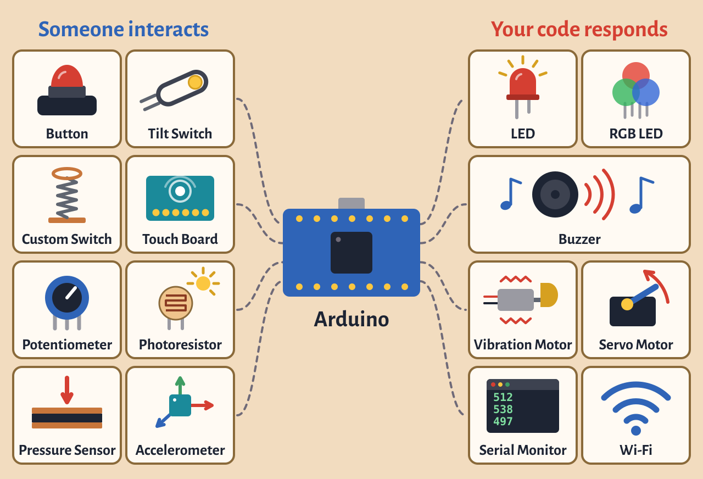

# Final Project

{alt="What we've covered in class. Someone interacts with a button, tilt switch, custom switch, touch board, potentiometer, photoresistor, pressure sensor or accelerometer. That goes into the Arduino. Your code responds with an LED, RGB LED, buzzer, vibration motor, servo motor, the Serial Monitor or Wi-Fi."}

Make something interactive with the Arduino that shows what you've learned in this class.

## Requirements

Your project must:

- **Use the Arduino.** Breadboard should not be visible.
- **Let someone interact with it**, using a sensor, button, keyboard, mouse or something else.
- **Respond through code.** When someone interacts with it, your code makes something happen: light, sound, motion or something on a computer.

**Every week:** Take photos of your progress and add them to your "Final Project" channel on Are.na.

## Timeline

::: {.timeline}
- **Week 11 (Nov 2–4): Think and research.** Create an Are.na channel called "Final Project". Put all your research and ideas there. Sketches, Inspiration, etc.
- **Week 12 (Nov 9–11): Share your proposal.** Your proposal is due Monday, November 9. Post it in the ["Final Project Proposals" thread on Canvas](https://canvas.uic.edu/courses/51541/assignments/450955){target="_blank"}. We'll look at everyone's ideas in class that day and give feedback. I will also go around with everyone individually to brainstorm and talk about how to carry out your project with what is available either in the lab or can be ordered online.
- **Week 13 (Nov 16–18): Start testing your idea.** Build a rough physical version that shows your idea can work. Upload photos to Are.na by the end of the week.
- **Week 14 (Nov 23): Build.** Start building the final version. Upload your progress to Are.na.
- **Week 15 (Nov 30): Finish.** Monday is a studio day for final touches and fixing problems. Upload your progress to Are.na.
- **Wednesday, December 2: Final critique.** Present your project, and take photos and videos of it that day.
:::

## What to Submit

Submit to the [Final Project assignment on Canvas](https://canvas.uic.edu/courses/51541/assignments/450951){target="_blank"} by the end of the day on December 2:

- Your Arduino sketch. The code should be more than just one of the built-in examples, with comments throughout explaining what it does.
- Your photos and videos from critique day. At least one photo of the object itself, and one video of it being interacted with. Must use the white backdrop documentation station that is located in the back of the class lab.
