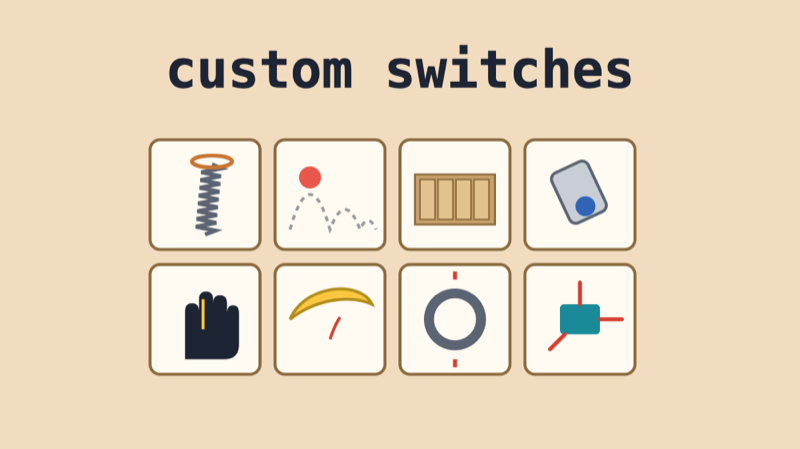

# Custom Switches & Interfaces

## Summary

A switch is just two pieces of metal that touch. A sensor is just something that changes when the world changes. Artists, musicians and designers have built switches and sensors into gloves, cardboard, doorknobs and bowls of water, and some of the most memorable interfaces come from a simple idea used in an unexpected place.

Look at each example and ask: **what is the switch or sensor, what does the person do to it, and what happens?** Then think about your own interface for the midterm.

## Switches in Unexpected Places

::: {.video-embed}
<iframe src="https://www.youtube.com/embed/SIfumZa2TKY" title="Michel Waisvisz: The Hands" loading="lazy" allow="accelerometer; autoplay; clipboard-write; encrypted-media; gyroscope; picture-in-picture; web-share" referrerpolicy="strict-origin-when-cross-origin" allowfullscreen></iframe>

**Michel Waisvisz, *The Hands* (first performed 1984)**  
Built at STEIM in Amsterdam, *The Hands* are two controllers strapped to the performer's hands. Waisvisz played electronic music by moving his hands, arms and fingers, instead of sitting at a keyboard.

**The switches:** push buttons under the fingers, **mercury tilt switches** that sense how the wrists and arms are turned (a liquid metal version of our ball tilt switch), and an ultrasonic sensor that measures the distance between the hands.
:::

::: {.video-embed}
<iframe src="https://www.youtube.com/embed/E4tYpXVTjxA" title="Touché: Enhancing Touch Interaction on Humans, Screens, Liquids, and Everyday Objects" loading="lazy" allow="accelerometer; autoplay; clipboard-write; encrypted-media; gyroscope; picture-in-picture; web-share" referrerpolicy="strict-origin-when-cross-origin" allowfullscreen></iframe>

**Disney Research and Carnegie Mellon University, *Touché* (2012)**  
A doorknob that knows how you're holding it, a table that knows how you're touching it, even a glass of water that reacts to your finger. *Touché* can turn almost any object, and even your own body, into a touch sensor with a single wire.

**The sensor:** capacitive touch, like the MPR121 touch board, taken further. Instead of only *touching* or *not touching*, it can tell apart one finger, a whole hand or a grip.
:::

## Variable Resistors and Motion

::: {.video-embed}
<iframe src="https://player.vimeo.com/video/43025087" title="Laetitia Sonami: Lady's Glove" loading="lazy" allow="autoplay; fullscreen; picture-in-picture" allowfullscreen></iframe>

**Laetitia Sonami, *Lady's Glove***  
Sound artist Laetitia Sonami performs with a glove she built and rebuilt over many versions. Every small movement of her fingers, hand and arm shapes the sound. She began making it partly as a playful answer to the bulky, high-tech gloves of virtual reality.

**The sensors:** **bend sensors** on the fingers (variable resistors that change as they bend, read with `analogRead()` just like our Velostat sensor), and **accelerometers** on the wrists.
:::

::: {.video-embed}
<iframe src="https://www.youtube.com/embed/kCV0FzG9Clw" title="Imogen Heap demonstrates her Mi.Mu gesture-control gloves" loading="lazy" allow="accelerometer; autoplay; clipboard-write; encrypted-media; gyroscope; picture-in-picture; web-share" referrerpolicy="strict-origin-when-cross-origin" allowfullscreen></iframe>

**Imogen Heap and the MI.MU team, *Mi.Mu gloves* (2014)**  
Musician Imogen Heap wanted to make music on stage by moving, more like dancing than pressing buttons. Raising a hand can climb through a scale, and a pinch and a twist can sweep a filter.

**The sensors:** bend sensors that track each finger, and a board with an **accelerometer**, a gyroscope and a compass that tracks how the hands move and point, sent to the computer over Wi-Fi.
:::

## Cardboard Mechanisms

::: {.video-embed}
<iframe src="https://www.youtube.com/embed/a8YhOUsWn5w" title="Nintendo Labo Variety Kit Overview Trailer" loading="lazy" allow="accelerometer; autoplay; clipboard-write; encrypted-media; gyroscope; picture-in-picture; web-share" referrerpolicy="strict-origin-when-cross-origin" allowfullscreen></iframe>

**Nintendo, *Nintendo Labo* (2018)**  
Kits of flat cardboard sheets that you fold into a piano, a fishing rod, a motorbike handle or a robot backpack. The game controller slots inside, and the cardboard becomes the interface.

**The mechanisms:** cardboard keys, levers, sliders and strings. Each moving part carries a small reflective sticker, and a tiny camera in the controller watches which stickers move. The controller's accelerometer and gyroscope sense how the whole thing is tilted and shaken.  
*(Video: overview trailer, uploaded by GameXplain.)*
:::

**Google, *Google Cardboard* (2014)**  
A virtual reality viewer folded from cardboard, with a phone inside as the screen. The first version had no electronics at all for its button: just two magnets.

**The switch:** one magnet glued inside the cardboard and a ring magnet on the outside. Sliding the outer magnet changes the magnetic field, and the phone's built-in **compass** senses the change as a button press. [How the magnet button works (K&J Magnetics)](https://www.kjmagnetics.com/blog/google-cardboard)

## Build Your Own

Every example above started with something simple: two contacts that touch, a sensor that bends, a magnet that moves. Try these, then make one that's yours.

::: {.topics}

::: {.card type="workshop" title="Doorstop Spring Switch" thumb="../../Workshops/Doorstop_Switch/images/cover.png" href="../../Workshops/Doorstop_Switch/doorstop_switch.html" tag="Workshop"}
:::

::: {.card type="workshop" title="Bouncing Ball Sensor" thumb="../../Workshops/Bouncing_Ball/images/cover.png" href="../../Workshops/Bouncing_Ball/bouncing_ball.html" tag="Workshop"}
:::

::: {.card type="workshop" title="DIY Pressure Sensor (Velostat)" thumb="../../Workshops/Velostat_Workshop/images/cover.jpg" href="../../Workshops/Velostat_Workshop/velostat_workshop.html" tag="Workshop"}
:::

::: {.card type="assignment" title="Midterm: Creative Interfaces" thumb="../Creative_Interfaces/images/cover.jpg" href="../Creative_Interfaces/creative_interfaces.html" tag="Assignment"}
:::

:::

### Questions for Your Interface

- What's the **simplest switch** that could do what you want: two contacts, a ball, a spring, a magnet?
- Does it need to be **on/off** (a switch) or **how much** (a variable resistor or an accelerometer)?
- What **material** does the person touch: cardboard, fabric, water, their own body?
- What **movement** triggers it: a press, a flick, a tilt, a squeeze, a bounce, a breath?
