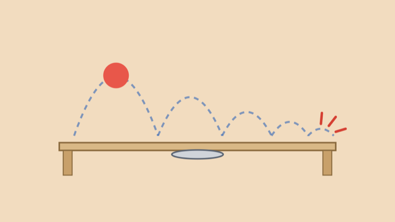
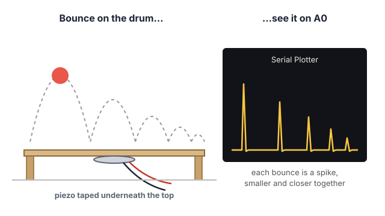
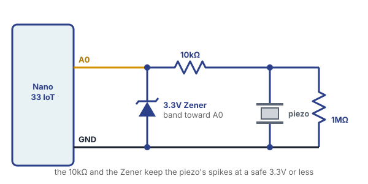

# Bouncing Ball Sensor



## Summary

Drop a ball on a cardboard drum and the Arduino hears every bounce. Under the drum is a **piezo**: a thin disc that makes a small voltage whenever it's bent or shaken. Each time the ball lands, the cardboard flexes, the piezo makes a spike of voltage, and `analogRead()` sees it.

Any ball works: a bouncy rubber ball, a ping pong ball, a tennis ball. And because the piezo tells us **how hard** each bounce hit and **when** it happened, we can do more than count: we can play a note for each bounce, and even measure **how high** the ball bounced.

### Steps

1. Build the drum: cardboard with a piezo taped underneath.
2. Wire the piezo to A0, with three parts that keep the Nano safe.
3. See the hits in the Serial Plotter.
4. Bounce Beep: a note for every bounce, higher for harder hits.
5. Bounce Melody: measure each bounce's height and turn it into a falling melody.

## How It Works



A **piezo** turns movement into voltage. (It also works the other way around: send it a voltage and it moves and makes a sound, which is how a buzzer works.) When the ball lands, the cardboard bends for an instant, the piezo bends with it, and it makes a short **spike** of voltage. A harder bounce bends it more and makes a taller spike.

As the ball settles, its bounces get **lower** and **closer together**, so the spikes in the Serial Plotter get smaller and closer together too.

## Tools & Materials

- Arduino Nano 33 IoT, USB cable and breadboard
- **Piezo element with wires** (Adafruit [1739](https://www.adafruit.com/product/1739)), or any piezo disc with wires
- **1MΩ resistor** (bands: brown, black, green)
- **10kΩ resistor** (bands: brown, black, orange)
- **3.3V Zener diode** (1N4728A): it looks like a regular diode, with a band on one end
- A **ball**: a bouncy rubber ball, a ping pong ball or a tennis ball
- **Cardboard**: a box lid, or a stiff sheet raised on four small blocks so the middle can flex
- Masking tape, jumper wires
- **Passive buzzer** or **STEMMA Speaker**, for Parts 4 and 5

## Part 1: Build the Drum

1. **Find a drum.** A shoebox lid or a small box works well: the top needs to flex a little when the ball lands, with air underneath it. A flat sheet of cardboard on the table won't work, because the table stops it from bending.
2. **Tape the piezo underneath the top, in the middle.** Press it flat against the cardboard and tape over it firmly. The piezo has to bend **with** the cardboard, so it shouldn't wobble or hang loose.
3. **Run the two wires out** the side of the box, and tape them down so they don't pull on the piezo.

## Part 2: Wire It to the Arduino



<blockquote class="warning">
<span class="uk-label" style="color:black; background:#fac100">Warning</span>
<p>A piezo hit hard can make a spike of <strong>much more than 3.3V</strong> for an instant, and the Nano 33 IoT's pins only take 3.3V. Don't connect the piezo straight to A0: always use the 10kΩ resistor and the Zener diode below.</p>
</blockquote>

What each part does:

- **1MΩ resistor, across the piezo:** lets the charge from each spike drain away, so the reading drops back to 0 between bounces. Without it, the reading would drift.
- **10kΩ resistor, between the piezo and A0:** limits how much current a big spike can push toward the pin.
- **3.3V Zener diode, from A0 to GND:** if a spike goes above 3.3V, the Zener lets the extra flow to GND, so A0 never sees more than about 3.3V. **The band goes toward A0**: if it's backwards, it acts like a regular diode and cuts every spike off at about 0.7V, so the readings never go above about 200.

On the breadboard, use three rows:

1. **Piezo row:** the piezo's **red** wire, one leg of the **1MΩ**, and one leg of the **10kΩ**.
2. **A0 row:** the other leg of the **10kΩ**, the **banded** end of the **Zener**, and a wire to **A0**.
3. **GND row:** the piezo's **black** wire, the other leg of the **1MΩ**, the other end of the **Zener**, and a wire to the Nano's **GND**.

## Part 3: See the Hits

Upload this sketch and open the **Serial Plotter**, set to **115200 baud**.

```arduino
// See the Hits: graph the piezo in the Serial Plotter.
// Each bounce shows up as a sharp spike.

int piezoPin = A0;

void setup() {
  Serial.begin(115200);
}

void loop() {
  Serial.println(analogRead(piezoPin));
}
```

Bounce the ball on the drum. Each bounce shows up as a sharp spike. Notice:

- How tall the spikes get for a hard bounce compared to a soft one.
- The **noise** when nothing is happening: small bumps near 0. Tapping the table makes spikes too: the piezo feels everything.
- How the spikes get smaller and closer together as the ball settles.

Write down roughly how tall the noise is. In the next sketches, `threshold` needs to be **above** the noise and **below** a soft bounce.

## Part 4: Bounce Beep

Now every bounce plays a note, and a harder bounce plays a higher one. Connect your speaker to **pin 8** (passive buzzer: other leg to GND; STEMMA Speaker: power to 3.3V, ground to GND, signal to pin 8).

```arduino
// Bounce Beep: every bounce plays a beep. A harder bounce plays a higher note.

int piezoPin = A0;
int speakerPin = 8;

int threshold = 40;   // readings above this count as a hit (raise it if quiet sounds trigger it)
int deadTime = 60;    // milliseconds to ignore after a hit, while the surface stops ringing

int bounces = 0;

void setup() {
  pinMode(speakerPin, OUTPUT);
  Serial.begin(115200);
}

void loop() {
  int reading = analogRead(piezoPin);

  if (reading > threshold) {
    // a hit: keep reading for 5 milliseconds to find how strong it was
    int peak = reading;
    unsigned long start = millis();
    while (millis() - start < 5) {
      int r = analogRead(piezoPin);
      if (r > peak) {
        peak = r;
      }
    }

    bounces = bounces + 1;
    Serial.print("Bounce ");
    Serial.print(bounces);
    Serial.print(": strength ");
    Serial.println(peak);

    // a stronger hit plays a higher note
    int pitch = map(peak, threshold, 1023, 200, 2000);
    pitch = constrain(pitch, 200, 2000);
    tone(speakerPin, pitch, 50);

    delay(deadTime);
  }
}
```

How it works:

- When a reading goes above `threshold`, we have a hit. We keep reading for 5 more milliseconds to find the **peak**, the tallest point of the spike, which tells us how hard the ball hit.
- `map()` and `constrain()` turn the peak into a pitch.
- After a hit, `delay(deadTime)` waits 60 milliseconds. The cardboard keeps ringing for a moment after each bounce, and without the wait, one bounce would count as several.

**Try it:**

- If quiet sounds or table taps trigger it, raise `threshold`. If soft bounces are missed, lower it.
- If one bounce counts twice, raise `deadTime`. If fast bounces at the end are missed, lower it.

## Part 5: Bounce Melody

The time between two bounces tells us how high the ball went in between: the ball spends half of that time going up and half coming down. From physics, something falling for a time *s* falls a distance of ½ × g × *s*², where **g = 9.8 m/s²** is gravity. With *s* = *t* ÷ 2:

**height = 9.8 × t × t ÷ 8** (in meters, with *t* in seconds)

So a gap of 0.6 seconds between bounces means the ball rose about **44 cm**, and a gap of 0.2 seconds means about **5 cm**.

This sketch measures every gap with `millis()`, works out the height, and plays a note: a higher bounce plays a higher note. Drop the ball and listen to the melody fall as it settles.

```arduino
// Bounce Melody: measure how high the ball bounced from the time between
// two bounces, and play a note for each bounce. As the ball settles, the
// bounces get lower and closer together, and the melody falls.

int piezoPin = A0;
int speakerPin = 8;

int threshold = 40;
int deadTime = 60;

unsigned long lastHit = 0;  // when the last bounce happened (milliseconds)

void setup() {
  pinMode(speakerPin, OUTPUT);
  Serial.begin(115200);
}

void loop() {
  int reading = analogRead(piezoPin);

  if (reading > threshold) {
    unsigned long now = millis();
    float seconds = (now - lastHit) / 1000.0;  // time since the last bounce
    lastHit = now;

    if (seconds < 2.0) {
      // the ball went up and came back down in that time, so it rose for half of it:
      // height = 9.8 × t × t ÷ 8   (in meters; × 100 for centimeters)
      float heightCm = 9.8 * seconds * seconds / 8.0 * 100.0;
      Serial.print("Bounce height: ");
      Serial.print(heightCm);
      Serial.println(" cm");

      // a higher bounce plays a higher note
      int pitch = map((int)heightCm, 0, 50, 200, 2000);
      pitch = constrain(pitch, 200, 2000);
      tone(speakerPin, pitch, 80);
    } else {
      // more than 2 seconds since the last bounce: this is a new drop
      Serial.println("New drop!");
      tone(speakerPin, 2000, 80);
    }

    delay(deadTime);
  }
}
```

Two new things:

- **`float`** is a kind of variable for numbers with a decimal point, like `0.6` or `44.1`. An `int` can only hold whole numbers, and our times and heights need decimals.
- **`(int)heightCm`** turns a `float` into an `int` (dropping the decimals), because `map()` works with whole numbers.

The first bounce after a drop has no bounce before it to measure from, so the sketch says "New drop!". A gap of more than 2 seconds also counts as a new drop.

**Try it:** drop the ball from a measured height, like 50 cm. Is the first measured bounce lower than where you dropped it from? How much height does the ball lose on each bounce? A ping pong ball and a rubber ball lose different amounts.

## Troubleshooting

- **The spikes never go above about 200, even for hard bounces.** The Zener is backwards: its band must face the A0 row.
- **The Serial Plotter shows only 0.**
  - Is the piezo taped flat to the cardboard? If it hangs loose, it doesn't bend.
  - Check that the piezo row and the A0 row are connected through the 10kΩ resistor.
- **The reading never drops back to 0, or slowly drifts.** The 1MΩ resistor is missing, or isn't across the piezo (piezo row to GND row).
- **It triggers when nothing is bouncing.** Raise `threshold`. Footsteps and typing on the same table can shake the drum: put it on a folded towel.
- **One bounce plays two notes.** Raise `deadTime`.
- **The heights look wrong.** Very light balls (like ping pong balls) are slowed down by the air, so they come back sooner than the formula expects, and their heights read a little low.

## Going Further

- **A drum kit:** tape piezos under several boxes (or several spots of one big box), each on its own analog pin (A0, A1, A2, A3) with its own resistors and Zener, each playing its own sound.
- **A knock lock:** the classic Arduino **Knock** example, where a secret pattern of knocks unlocks something.
- **Games:** a ping pong scoreboard that counts bounces, a "keep it bouncing" game, or a target with a piezo under each zone.
- **Send it to p5.js:** print the strength and height of each bounce to Serial, and draw them in a p5.js sketch.
- **Not just balls:** footsteps on a floor tile, raindrops on a box, a door knocker.
