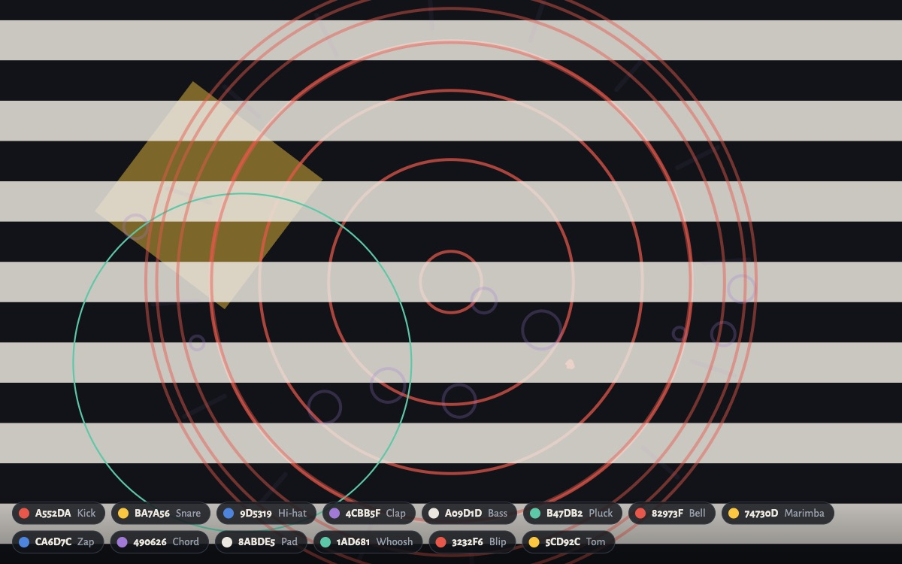
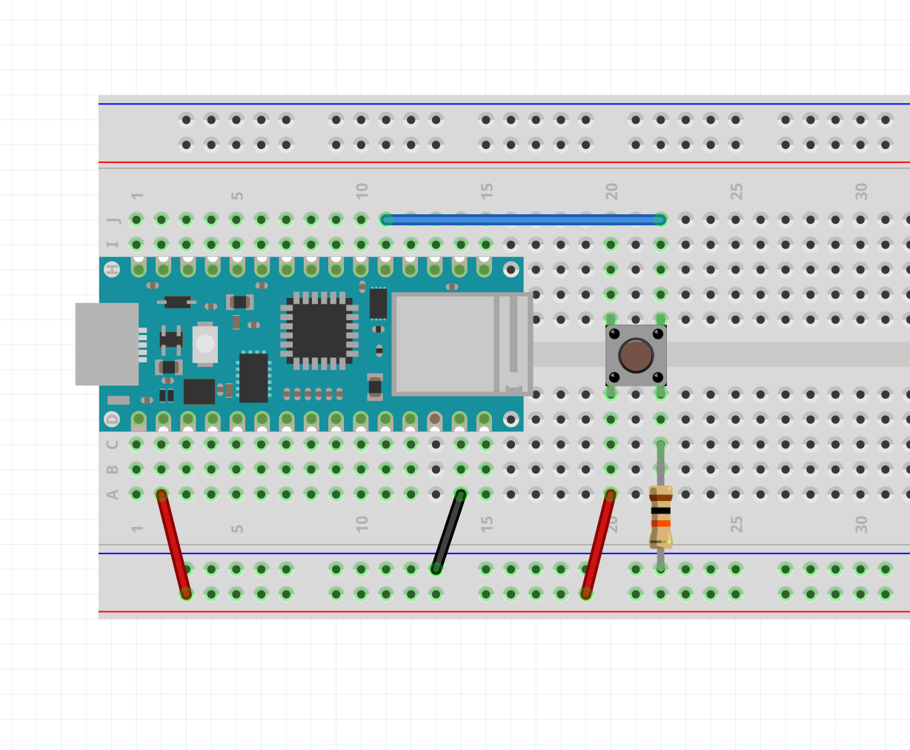

# Class Band



## Summary

Let's end the day by playing music together. Every one of you wires a **push button** to your Arduino and sends it over **Wi-Fi** to the projector, the same way we sent our Velostat sensors to the Class Sensor Grid. Each board gets its **own sound and animation**, like the keys on [Patatap](https://patatap.com/). Press your button and the whole room hears it.

## Tools & Materials

- Arduino Nano 33 IoT and USB cable
- Breadboard
- Push button
- 10kΩ resistor (bands: brown, black, orange)
- Jumper wires

## 1. Wire the Button

This is the same circuit as Monday's **Button** sketch, with the button on **pin 2**.

- One leg of the button goes to **3.3V**.
- The button's other leg goes to **pin 2**.
- The **10kΩ resistor** goes from **pin 2** to **GND**. This is the pull-down resistor: it keeps pin 2 at LOW (0V) while the button isn't pressed.

Push buttons have four legs. Place the button **across the middle gap** of the breadboard: the two legs directly across the gap from each other are always connected, so the button joins two rows (columns 20 and 22 in the drawing). Pressing it connects those two rows.

<a href="images/button_circuit.png" target="_blank" title="Open the drawing full size"></a>

*Click the drawing to open it full size.*

With the **USB cable unplugged**:

1. **Take the power module off** your breadboard. The Arduino powers this circuit through the + and – rails, and the module would put its own power on them too.
1. **Red wire: 3.3V pin → bottom + rail.** **3.3V** is the second pin from the USB end, on the same side as A0.
2. **Black wire: GND pin → bottom – rail.** This **GND** is on the same side, second from the far end (next to VIN).
3. **Button across the middle gap**, a few rows to the right of the Nano.
4. **Red wire: one side of the button (column 20) → + rail.**
5. **Blue wire: D2 pin → the other side of the button (column 22).** **D2** is on the other side of the Nano, the eleventh pin from the USB end.
6. **10kΩ resistor: column 22 → – rail.** It shares the row with the blue wire, so it pulls pin 2 down to GND.

The pin names are printed on the Nano next to each pin, so check them as you go. **Don't** use the 5V or VUSB pin.

When you press the button, pin 2 reads HIGH and the Arduino sends `1023`. When you let go, it reads LOW and sends `0`.

## 2. Upload the Sketch

You already installed the **WiFiNINA** library for the Class Sensor Grid. If you're on a different computer, install it from the **Library Manager**.

1. Make a new sketch (**File** > **New Sketch**), delete everything in it, and paste in the whole sketch below.
2. Change `ROUTER_NAME` and `ROUTER_PASSWORD` to the Wi-Fi name and password on the board. Keep the quotes.
3. Choose **Tools** > **Board** > **Arduino SAMD Boards** > **Arduino Nano 33 IoT**, and your board's **Port**.
4. Click **Upload**.
5. Open the **Serial Monitor** (115200 baud). It prints your **board ID**, and `pressed` / `released` as you use the button.

The built-in LED blinks while the board joins the Wi-Fi and stays on once it's connected. Find the chip with your board ID at the bottom of the projector screen: that's your sound.

<a href="../Velostat_Workshop/station/class_button/class_button.ino" download>Download class_button.ino</a>

```arduino
/*
  Class Button (ART 150, Class Band)

  Every student uploads this same sketch to their own Arduino Nano 33 IoT.
  It reads one push button wired like Monday's Button sketch:

      3.3V -> button -> pin 2 -> 10k resistor -> GND

  and sends it over Wi-Fi to the teacher's laptop, where your button plays
  its own sound and animation on the Class Band page. Pressed sends 1023,
  released sends 0.

  The only lines to change are the Wi-Fi name and password just below.

  The Serial Monitor (115200 baud) prints "pressed" and "released" as you
  press, even if the Wi-Fi doesn't connect. Lines starting with "#" tell
  you what the Wi-Fi is doing, including your board's ID.

  The built-in LED blinks while joining the Wi-Fi and stays on once
  connected.

  How it works: every board has a unique hardware address (its MAC
  address), so the last six characters of it become this board's ID and
  nobody has to pick a number. A press goes out the moment it happens, as
  a line like "B3F9A21,1023" over UDP, and the button's state is repeated
  about 15 times a second in case a message gets lost. The laptop's
  relay.py announces itself on the network once a second; the board sends
  straight to it once it hears that, and to the whole network until then.
*/

#include <SPI.h>
#include <WiFiNINA.h>
#include <WiFiUdp.h>

// ---- change these two lines to the classroom router's 2.4 GHz network ----
const char WIFI_NAME[] = "ROUTER_NAME";
const char WIFI_PASSWORD[] = "ROUTER_PASSWORD";

const int BUTTON_PIN = 2;
const unsigned int UDP_PORT = 9000;     // relay.py listens here
const unsigned int BEACON_PORT = 9001;  // relay.py announces itself here
const unsigned long SEND_EVERY = 66;    // ms: repeat the state ~15 times a second
const unsigned long DEBOUNCE = 15;      // ms the button must stay still to count

int buttonState = LOW;         // the last state we sent
int lastReading = LOW;         // the last raw reading
unsigned long lastChange = 0;  // when the raw reading last changed
unsigned long lastSend = 0;

char boardId[7];  // e.g. "3F9A21"
WiFiUDP udp;
IPAddress broadcastIP;
IPAddress relayIP;             // learned from the relay's announcements
unsigned long lastBeacon = 0;  // when we last heard one
bool relayKnown = false;
unsigned long lastWifiTry = 0;
bool wifiReady = false;

void setup() {
  Serial.begin(115200);
  pinMode(LED_BUILTIN, OUTPUT);
  pinMode(BUTTON_PIN, INPUT);  // the 10k resistor pulls it LOW when not pressed

  if (WiFi.status() == WL_NO_MODULE) {
    Serial.println("# wifi: no Wi-Fi module found");
    strcpy(boardId, "000000");
    return;
  }
  // the MAC address comes back last byte first: mac[0] is the end of it
  byte mac[6];
  WiFi.macAddress(mac);
  snprintf(boardId, sizeof(boardId), "%02X%02X%02X", mac[2], mac[1], mac[0]);
  printId();

  // an out-of-date Wi-Fi chip makes joining slow or flaky; say so at startup
  String fw = WiFi.firmwareVersion();
  if (fw < WIFI_FIRMWARE_LATEST_VERSION) {
    Serial.print("# wifi: chip firmware ");
    Serial.print(fw);
    Serial.print(" is out of date (Arduino IDE > Tools > Firmware Updater)");
    Serial.println();
  }
  connectWifi();
}

void printId() {
  Serial.print("# board ID: ");
  Serial.println(boardId);
}

// Join the network. Even when WiFi.begin() reports a failure, the Wi-Fi chip
// keeps trying on its own, and on a weak signal that can take 20+ seconds.
// Calling begin() again restarts that attempt from scratch, so we leave it
// 30 seconds between tries (and keep printing readings meanwhile).
void connectWifi() {
  lastWifiTry = millis();
  if (WiFi.status() == WL_NO_MODULE) return;
  Serial.print("# wifi: joining \"");
  Serial.print(WIFI_NAME);
  Serial.println("\"...");
  digitalWrite(LED_BUILTIN, HIGH);
  int status = WiFi.begin(WIFI_NAME, WIFI_PASSWORD);
  digitalWrite(LED_BUILTIN, LOW);
  if (status == WL_CONNECTED) startSending();
  else {
    Serial.print("# wifi: could not join \"");
    Serial.print(WIFI_NAME);
    Serial.println("\" yet. Check the name and password; trying again in 30 s");
  }
}

// Once on the network (whether our WiFi.begin() did it or the Wi-Fi chip
// reconnected by itself), work out where to send and open the socket.
void startSending() {
  // send to the whole network (e.g. 192.168.1.255) until the relay is found
  IPAddress ip = WiFi.localIP();
  IPAddress mask = WiFi.subnetMask();
  for (int i = 0; i < 4; i++) {
    broadcastIP[i] = ip[i] | (~mask[i] & 0xFF);
  }
  WiFi.noLowPowerMode();  // keep the radio awake: steadier, faster sends
  udp.begin(BEACON_PORT);  // listen for the relay; we send to UDP_PORT
  wifiReady = true;
  Serial.print("# wifi: joined, address ");
  Serial.println(ip);
  printId();
}

// The relay sends "RELAY" to BEACON_PORT once a second.
void listenForRelay() {
  while (udp.parsePacket() > 0) {
    char buf[8] = { 0 };
    udp.read(buf, sizeof(buf) - 1);
    if (strncmp(buf, "RELAY", 5) == 0) {
      if (!relayKnown || udp.remoteIP() != relayIP) {
        Serial.print("# wifi: found the class grid at ");
        Serial.println(udp.remoteIP());
      }
      relayIP = udp.remoteIP();
      relayKnown = true;
      lastBeacon = millis();
    }
  }
}

void send(const char *msg, int len) {
  // straight to the laptop if we've heard it lately, otherwise everyone
  bool direct = relayKnown && millis() - lastBeacon < 5000;
  udp.beginPacket(direct ? relayIP : broadcastIP, UDP_PORT);
  udp.write((const uint8_t *)msg, len);
  udp.endPacket();
}

void sendState() {
  char line[20];
  int len = snprintf(line, sizeof(line), "B%s,%d", boardId, buttonState == HIGH ? 1023 : 0);
  send(line, len);
  lastSend = millis();
}

void loop() {
  // keep the Wi-Fi up, and show its state on the built-in LED
  if (WiFi.status() == WL_CONNECTED) {
    digitalWrite(LED_BUILTIN, HIGH);
    if (!wifiReady) startSending();
    // every 5 s, report the signal strength (closer to 0 is stronger;
    // below about -75 dBm, presses start getting lost) as "R3F9A21,-62"
    static unsigned long lastSignal = 0;
    if (wifiReady && millis() - lastSignal > 5000) {
      lastSignal = millis();
      char msg[20];
      int n = snprintf(msg, sizeof(msg), "R%s,%ld", boardId, WiFi.RSSI());
      send(msg, n);
    }
  } else if (WiFi.status() != WL_NO_MODULE) {
    if (wifiReady) {
      udp.stop();  // reopened by startSending() after reconnecting
      wifiReady = false;
      relayKnown = false;
      Serial.println("# wifi: lost the connection, reconnecting");
    }
    digitalWrite(LED_BUILTIN, (millis() / 250) % 2);  // blink
    if (millis() - lastWifiTry > 30000) connectWifi();
  }

  // read the button, ignoring the quick flickers (bounce) of the contacts
  int reading = digitalRead(BUTTON_PIN);
  if (reading != lastReading) {
    lastReading = reading;
    lastChange = millis();
  }
  bool changed = false;
  if (reading != buttonState && millis() - lastChange >= DEBOUNCE) {
    buttonState = reading;
    changed = true;
    Serial.println(buttonState == HIGH ? "pressed" : "released");
  }

  if (wifiReady) {
    listenForRelay();
    if (changed) {
      sendState();
      if (buttonState == HIGH) sendState();  // a press goes out twice, in case one is lost
    } else if (millis() - lastSend >= SEND_EVERY) {
      sendState();
    }
  }
  delay(1);
}
```

## 3. Play

- Press your button and listen for your sound. Your chip at the bottom of the screen lights up.
- Try playing together: one person keeps a steady beat on the **Kick**, others answer on the **Snare** and **Hi-hat**, and the melodic sounds (**Pluck**, **Bell**, **Marimba**) play a little more each time they're pressed.

## How It Works

- **Your board** checks the button about a thousand times a second. When the button changes, it sends a short message like `B3F9A21,1023` over Wi-Fi right away. It also repeats the button's state about 15 times a second, in case a message gets lost.
- **My laptop** runs a small python program (`relay.py`) that receives every board's messages and passes them to a web page.
- **The web page** gives each new board a sound and an animation. When a board's number jumps up, it plays them. The sounds are made in the browser with the **Web Audio API**, and the animations are drawn on a **canvas**, just like a p5.js sketch.

## Troubleshooting

- **No chip with your board ID.** Check that the Serial Monitor says `found the class grid`. If it says `could not join`, check the Wi-Fi name and password, including capital letters.
- **The Serial Monitor never says `pressed`.** Is the button across the middle gap, with one leg on 3.3V and the other on pin 2? Try turning the button 90 degrees.
- **It says `pressed` all the time.** The 10kΩ resistor is missing, or it isn't between pin 2 and GND.
- **Upload fails or the port is missing.** Try another USB cable (some only charge), or double-tap the Nano's reset button and pick the port again.
