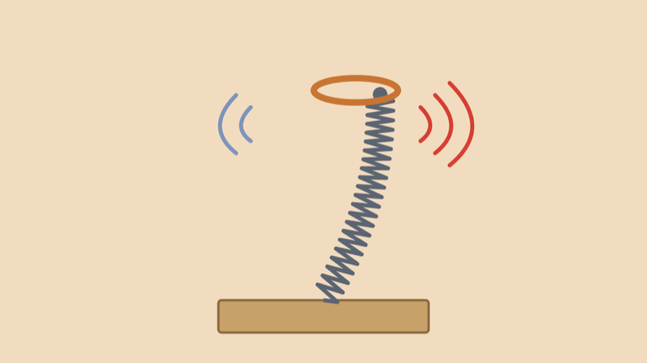
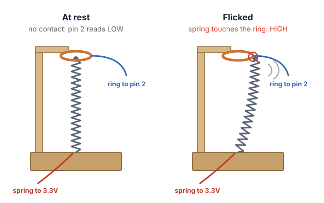
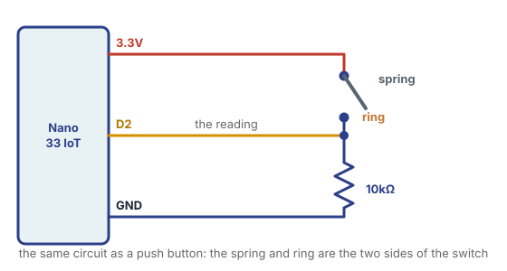

# Doorstop Spring Switch



## Summary

A **doorstop spring** is the springy coil you find screwed into a wall or baseboard so a door doesn't hit it. Flick it and it wobbles back and forth with a "boing" sound. Today we turn one into a **switch**: we put a metal ring around its tip, and every time the spring wobbles into the ring, it closes a circuit, just like pressing a button.

A button is pressed once. A flicked spring touches the ring **many times** in a row as it settles, and a harder flick makes more touches. That makes it a great switch for playful interfaces: an instrument, a game controller, or anything that should react to a flick, a knock or a breeze.

### Steps

1. Build the switch: the spring, a cardboard base, and a copper ring.
2. Wire it to the Arduino, the same way as a push button.
3. Count the bounces in the Serial Monitor.
4. Make it boing: a short sound on every touch.
5. Count flicks instead of bounces, and turn the strength of a flick into a note.

## How It Works



The spring and the ring are the **two sides of a switch**:

- The **spring** is connected to **3.3V**.
- The **ring** is connected to **pin 2**.
- When they don't touch, a **10kΩ pull-down resistor** keeps pin 2 at LOW (0V), just like in Monday's Button sketch.
- When the spring touches the ring, current flows from 3.3V to pin 2, and it reads HIGH.

Doorstop springs are made of steel, which conducts electricity, so the whole spring works as a wire.

## Tools & Materials

From the **hardware store** (about $1–2 each):

- **Doorstop spring**, the coiled kind with a screw at the base and a rubber cap on the tip

From your **electronics kit**:

- Arduino Nano 33 IoT, USB cable and breadboard
- **10kΩ resistor** (bands: brown, black, orange)
- **Jumper wires** and **alligator clips**
- **Passive buzzer** or **STEMMA Speaker**, for Parts 4 and 5

Provided by the lab:

- **Cardboard**, scissors or a box cutter, and masking tape or hot glue
- **Copper tape** (or bare solid-core wire, or aluminum foil) for the ring
- **Multimeter**, to check that your spring conducts

## Part 1: Build the Switch

1. **Pull the rubber cap off the tip of the spring.** The metal tip needs to touch the ring, and rubber doesn't conduct. If the spring is painted, sand a small spot at the tip and at the base so bare metal shows.
2. **Make a base.** Stack and glue two or three layers of cardboard, about 10 cm square. A heavier base keeps the spring from tipping the whole thing over when you flick it.
3. **Mount the spring.** Push the screw at the bottom of the spring through the cardboard and tape or glue it underneath so it stands straight up and doesn't wobble at the base.
4. **Make the ring.** Cut a cardboard strip about 2 cm wide. Cut a hole in it a little bigger than the spring's tip (about 2 cm across), and line the inside of the hole with **copper tape** so it makes a metal ring. You can also bend a loop of bare wire.
5. **Hold the ring around the tip.** Fold a cardboard post or arm, and tape it to the base so the ring sits around the tip of the spring **without touching it**. Leave a gap of a few millimeters all around.
6. **Check it with a multimeter** (continuity mode, the one that beeps): put one probe on the base of the spring and one on the copper ring. It should be silent at rest and **beep when you push the spring into the ring**.

The size of the gap changes how the switch feels: a small gap makes it touch even with a gentle flick, a big gap needs a hard flick.

## Part 2: Wire It to the Arduino



This is the **same circuit as a push button**, with the spring and the ring as the two sides of the switch:

- **Spring** → **3.3V** (an alligator clip on the bottom coils of the spring)
- **Ring** → **pin 2** (an alligator clip on the copper tape)
- **10kΩ resistor** from **pin 2** to **GND**

Tip: tape the alligator clips' wires down to the base, so they don't pull on the spring or the ring.

## Part 3: Count the Bounces

Upload this sketch and open the **Serial Monitor** (9600 baud). Every time the spring touches the ring, the count goes up, and the built-in LED blinks.

```arduino
// Bounce Counter: count every time the spring touches the ring.

int springPin = 2;

int lastState = LOW;  // was the spring touching the ring last time?
int contacts = 0;     // how many times it has touched so far

void setup() {
  pinMode(springPin, INPUT);
  pinMode(LED_BUILTIN, OUTPUT);
  Serial.begin(9600);
}

void loop() {
  int state = digitalRead(springPin);

  // the built-in LED is on while the spring touches the ring
  digitalWrite(LED_BUILTIN, state);

  // count it only when the spring goes from not touching to touching
  if (state == HIGH && lastState == LOW) {
    contacts = contacts + 1;
    Serial.println(contacts);
  }
  lastState = state;
}
```

Flick the spring once and watch the numbers: **one flick counts many times**, maybe 5, maybe 30. The spring wobbles in and out of the ring as it settles, and the Arduino checks the pin thousands of times a second, so it sees every touch.

This is called **bouncing**, and every switch does it a little, even a push button (its metal contacts bounce for a few milliseconds). Usually we have to filter it out. With a spring, the bounces are the fun part.

Notice that `loop()` has **no `delay()`**: the spring touches the ring for only a few milliseconds at a time, and a `delay()` would make the Arduino miss them.

## Part 4: Make It Boing

Now every touch plays a very short beep, so one flick sounds like a buzzy, rhythmic "brrrr" that slows down as the spring settles.

Connect your speaker to **pin 8**:

- **Passive buzzer:** one leg to **pin 8**, the other to **GND** (like the [Passive Buzzer](../../Arduino/buzzer_speaker/buzzer_speaker.html) lesson).
- **STEMMA Speaker:** power to **3.3V**, ground to **GND**, signal to **pin 8**, using alligator clips. Turn the volume knob with a small screwdriver if it's too quiet.

```arduino
// Spring Boing: play a short click of sound every time the spring touches the ring.

int springPin = 2;
int speakerPin = 8;

int lastState = LOW;

void setup() {
  pinMode(springPin, INPUT);
  pinMode(speakerPin, OUTPUT);
}

void loop() {
  int state = digitalRead(springPin);

  if (state == HIGH && lastState == LOW) {
    tone(speakerPin, 880, 15);  // a very short beep: 880 Hz for 15 milliseconds
  }
  lastState = state;
}
```

**Try it:**

- Change `880` to a different pitch, or make it random with `random(200, 2000)`.
- Make the beep longer or shorter by changing `15`.

## Part 5: Count Flicks, Not Bounces

What if you want the spring to work like a button: **one flick, one action**? We count the bounces, and when the spring has been quiet for 300 milliseconds, we decide the flick is over. Then we use the number of bounces as the **strength** of the flick: a harder flick plays a higher note.

```arduino
// Flick Strength: count the bounces in one flick, then play a note.
// A harder flick makes the spring bounce more, so it plays a higher note.

int springPin = 2;
int speakerPin = 8;

int lastState = LOW;
int bounces = 0;               // bounces in the current flick
unsigned long lastBounce = 0;  // when the last bounce happened (in milliseconds)

void setup() {
  pinMode(springPin, INPUT);
  pinMode(speakerPin, OUTPUT);
  Serial.begin(9600);
}

void loop() {
  int state = digitalRead(springPin);

  if (state == HIGH && lastState == LOW) {
    bounces = bounces + 1;
    lastBounce = millis();  // remember when it happened
  }
  lastState = state;

  // no bounce for 300 milliseconds: the spring has settled, so the flick is over
  if (bounces > 0 && millis() - lastBounce > 300) {
    Serial.print("Flick! Bounces: ");
    Serial.println(bounces);

    int pitch = map(bounces, 1, 30, 200, 2000);
    pitch = constrain(pitch, 200, 2000);
    tone(speakerPin, pitch, 300);

    bounces = 0;  // get ready for the next flick
  }
}
```

Two new things:

- **`millis()`** gives the number of milliseconds since the Arduino started. We save it in `lastBounce` at every bounce. Then `millis() - lastBounce` tells us how long it's been since the last one, **without** using `delay()`, so we don't miss any bounces while waiting.
- `unsigned long` is a kind of variable for very big, never-negative numbers. `millis()` gets big fast (there are 86,400,000 milliseconds in a day), so we store it in an `unsigned long` instead of an `int`.

`map()` and `constrain()` turn the number of bounces (1 to 30) into a pitch (200 to 2000 Hz). Open the Serial Monitor to see how many bounces your flicks make, and change the `30` to fit your spring.

**Try it:** flick it softly, then hard. Can you play a melody by controlling how hard you flick?

## Troubleshooting

- **Nothing happens when the spring touches the ring.**
  - Is the rubber cap off the tip? Is the spring painted? Sand a spot at the tip and where the alligator clip holds it.
  - Check with the multimeter: it should beep between the spring's base and the ring when they touch.
  - Is the ring connected to **pin 2**, and the 10kΩ resistor in the same row as pin 2?
- **It counts all the time, even when nothing is touching.** The 10kΩ resistor is missing, or isn't connected between pin 2 and GND. Without it, pin 2 "floats" and reads random values.
- **It reads HIGH all the time.** The spring is resting against the ring. Make the hole bigger or center the ring around the tip.
- **The whole base tips over.** Add more cardboard layers, or tape the base to the table.
- **No sound.** Check that the speaker is on **pin 8** and **GND**. A passive buzzer needs `tone()`; the kit's active buzzer only beeps at one pitch.

## Going Further

- **An instrument:** build three or four springs, each on its own pin, each with its own note.
- **Join the Class Band:** replace the button in the [Class Band](../Class_Band/class_band.html) sketch with your spring.
- **Different springs:** springs of different lengths and stiffness wobble at different speeds. A longer spring wobbles slower and bounces longer.
- **Not just flicks:** put the spring where something else will move it: a door, a fan, a pet, the wind, footsteps on a table.
- **Hear the spring itself:** doorstop springs make great sounds on their own. Experimental musicians and sound artists often amplify them with a contact microphone.
